# MCP Lens v2 — 독립성 판정과 고지된 전역 가역 조치

> **정의**: MCP Lens v2는 Claude Code와 Codex의 전체 세션을 관측해 미사용 MCP 툴을 찾고,
> 툴 간 의존성을 보수적으로 판정한 뒤 사용자가 기능과 위험을 이해한 상태에서 전역으로
> 비활성화하고 필요하면 즉시 복구하게 하는 로컬 도구다.
>
> **한 줄 요약**: 전역 관측 → 독립성 판정 → 영어 기능·위험 고지 → 전역 비활성화 →
> 후회 감지 → 원클릭 복구.

- 문서 상태: v2 제품·기술 설계 기준
- 작성 기준일: 2026-08-03
- 상위 결정: `docs/designs/2026-08-02-v2-v3-로드맵과-원칙.md`
- 현재 구현 설명: `docs/system-flow.md`
- 이전 문서: 이 파일의 Git 이력. 이전 내용은 현재 제품의 v1 관측 아키텍처를 설명한다.

---

## 1. 배경과 문제

v1은 Claude Code·Codex·Gemini CLI의 세션 로그와 공식 Hook에서 실제 MCP 툴 사용을 모으고,
설정에 등록된 서버의 `tools/list`를 스캔해 정의 비용과 사용량을 결합한다. 이 관측 계층은
어떤 툴이 비싸고 얼마나 쓰였는지를 알려주지만, **미사용이라는 사실만으로 비활성화가
안전한지는 알려주지 못한다.**

미사용 툴을 바로 차단할 때 생기는 위험은 세 가지다.

1. **시간적 사각**: 관찰 기간에는 쓰지 않았지만 월말·장애·복구 시점에만 필요한 툴일 수 있다.
2. **구조적 사각**: 다른 툴의 결과나 선행 동작이 해당 툴에 의존할 수 있다.
3. **범위 오판**: 프로젝트 단위 데이터로 판단한 조치를 사용자 전역에 적용하면 다른
   프로젝트를 깨뜨릴 수 있다.

v2는 이 문제를 삭제 전 완벽한 예측으로 해결하려 하지 않는다. 모든 프로젝트의 관측을 합산하고,
결정적 신호와 LLM 의미 판정을 결합해 안전 후보를 좁히며, 조치 뒤 다시 필요해진 흔적을 감지해
복구를 권한다. 권고는 정답 선언이 아니라 **관측되고 회수 가능한 실험**이다.

---

## 2. 제품 원칙

### 2-1. 전역 관측과 전역 조치를 일치시킨다

사용량과 호출 이력은 특정 프로젝트가 아니라 Lens가 수집한 모든 세션을 합산한다. 따라서 v2의
조치 범위도 사용자 전역으로 고정한다. 프로젝트별 차단 선택지는 제공하지 않는다.

단, 같은 서버 이름이 서로 다른 command 또는 URL을 가리키면 전역 합산 자체가 오염될 수 있다.
모든 설정 소스의 서버 정체성을 대조해 이름 충돌이 발견되면 판정을 `Review required`로 내리고
비활성화를 금지한다.

### 2-2. 비가역 조작은 없다

UI에서 `Delete`나 `Remove`라는 말을 사용하지 않는다. 실제 동작은 설정 규칙을 추가하는
`Disable globally`와 Lens가 추가한 규칙을 제거하는 `Restore globally`다. 변경 전 백업,
조치 원장, 원클릭 복구가 없는 쓰기 경로는 만들지 않는다.

### 2-3. 측정과 판정의 한계를 숨기지 않는다

- 실측·하한 추정·전량 가정·측정 불가를 구분한다.
- `o200k_base` 토큰 수는 Claude·Codex의 실제 토크나이저와 다를 수 있음을 표시한다.
- Codex 후회 감지는 간접 신호이며 `Experimental`로 표시한다.
- 데이터가 부족하거나 형식이 불명확하면 안전 판정을 만들지 않는다.

### 2-4. LLM 비용과 전송 범위를 먼저 고지한다

독립성 판정은 사용자의 Claude 또는 Codex CLI 계정으로 실행된다. 최초 호출 전에 선택 CLI,
모델, 예상 토큰, API 환산 비용, 전송·비전송 데이터, 캐시 조건을 영어로 고지하고 동의를 받는다.
동의 전에는 CLI를 실행하지 않으며 철회 후에는 자동 재분석을 중단한다.

### 2-5. fail-open

추론 CLI 부재, 타임아웃, 비정상 종료, 출력 검증 실패, 설정 파싱 실패가 발생하면 해당 기능만
`Review required`로 닫는다. v1의 수집·회계·리포트는 계속 동작한다. 읽지 못한 설정에는 쓰지 않는다.

---

## 3. 목표, 비범위와 완료 조건

### 목표

- 모든 프로젝트의 전역 관측 데이터로 미사용 툴 후보를 만든다.
- 정적 참조, 호출 연쇄, LLM 의미 분석으로 Claude Code·Codex 툴의 독립성을 판정한다.
- 독립 툴에 한해 영어 기능 요약과 비활성화 위험을 생성한다.
- 사용자가 고지를 확인한 뒤 클라이언트별로 전역 비활성화한다.
- 조치 뒤 필요 신호를 감지하고 사용자가 원클릭으로 복구하게 한다.

### 비범위

- Gemini CLI의 조치 기능
- 프로젝트별 비활성화
- 서버 전체 자동 비활성화
- 사용자 확인 없는 일괄 압축
- 의존 세트 단위 비활성화
- 자동 복구
- MCP `tools/list` 원문을 요약본으로 교체하는 정의 다이어트
- 사용자 프롬프트나 툴 입출력을 다시 LLM으로 분석하는 후회 감지

### 완료 조건

Claude Code와 Codex에서 다음 폐루프가 동작해야 한다.

```text
전역 관측
  → 비활성화 자격 검사
  → 3계층 독립성 판정
  → 영어 기능·위험 고지
  → 사용자 승인
  → 전역 비활성화
  → 후회 신호 감시
  → 복구 제안
  → 원클릭 전역 복구
```

Codex 후회 감지는 정확한 툴명 검색 실패만 잡는 실험적 기능으로 완료 조건에 포함한다.
의미가 비슷한 검색까지 잡는 높은 재현율은 v2 완료 조건이 아니다.

---

## 4. 사용자 흐름

1. Lens가 기존 전역 회계에서 호출 0회인 고확신 후보를 찾는다.
2. 최초 미분석 서버가 있으면 비용·데이터 동의 화면을 표시한다.
3. 사용자가 동의하면 미분석 서버들을 가능한 한 한 번의 격리된 CLI 호출로 분석한다.
4. 결과를 `Independent`, `Review required`, `Dependent`로 표시한다.
5. `Independent`이면서 모든 eligibility 조건을 통과한 툴만 `Safe to disable`에 나타난다.
6. 상세 화면에서 영어 요약·손실·위험·판정 근거·전역 영향을 확인한다.
7. Claude Code 또는 Codex의 `Disable globally`를 각각 실행한다.
8. 새 클라이언트 세션부터 변경이 적용된다.
9. 후회 신호가 쌓이면 `Restore recommended`를 표시한다.
10. 사용자가 `Restore globally`를 누르면 Lens가 소유한 규칙만 제거한다.

비활성화는 클라이언트별 독립 조치다. Claude 변경 실패를 이유로 Codex를 자동 변경하거나,
그 반대 방향으로 보상 쓰기를 하지 않는다.

---

## 5. 시스템 아키텍처

```mermaid
flowchart LR
    OBS[기존 전역 관측 데이터] --> ELIG[Eligibility Engine]
    DEF[정의 원문·설정 소스] --> ID[Server Identity Resolver]
    ID --> ELIG
    ELIG --> STATIC[정의 참조 검사]
    STATIC --> SEQ[호출 연쇄 분석]
    SEQ --> CACHE{서버 캐시 존재?}
    CACHE -->|yes| RESULT[Dependency Result]
    CACHE -->|no| BATCH[Inference Batch Planner]
    BATCH --> CLI[Claude or Codex CLI]
    CLI --> VALIDATE[Schema Validator]
    VALIDATE --> RESULT
    RESULT --> UI[VS Code Sidebar · Details]
    UI --> ACTION[Global Action Adapter]
    ACTION --> CLAUDE[Claude permissions.deny]
    ACTION --> CODEX[Codex disabled_tools]
    CLAUDE --> REGRET[Regret Detector]
    CODEX --> REGRET
    REGRET --> UI
```



### 컴포넌트 책임

| 컴포넌트 | 책임 |
|---|---|
| Server Identity Resolver | 클라이언트·설정 소스별 command/URL을 정규화하고 이름 충돌을 탐지 |
| Eligibility Engine | 전역 사용량·관찰량·수집 건강도·정체성 충돌을 조합해 조치 가능 여부 결정 |
| Dependency Analyzer | 정적 참조, 방향성 호출 연쇄, LLM 의미 판정을 순서대로 결합 |
| Inference Batch Planner | 미분석 서버를 컨텍스트 한도 안에서 최소 호출 수로 묶음 |
| Inference Provider | `auto | claude | codex` 선택, 영어 프롬프트 전달, 구조화 결과 수신 |
| Analysis Cache | 서버별 정의 해시와 규칙 버전으로 판정·영어 설명 재사용 |
| Global Action Adapter | Claude JSON·Codex TOML의 안전한 전역 비활성화와 복구 |
| Regret Detector | Claude 직접 증거와 Codex 실험적 간접 증거를 조치 원장에 연결 |

판정·캐시·설정 변경 계약은 `@mcp-lens/core`에 둔다. VS Code 확장은 UI, 동의, CLI 실행 수명주기만
담당하며 core는 `vscode`를 import하지 않는다.

---

## 6. 비활성화 자격 검사

LLM 호출 전에 결정 가능한 탈락 조건을 먼저 적용한다. 다음 조건을 모두 만족해야 분석 후보가 된다.

1. 기존 엔진 판정이 호출 0회의 `remove` 또는 `filter-server` 후보다.
2. 기존 증거 등급이 `high`다. 현재 계약상 시작 시각이 확인된 세션을 포함해 최소 10세션,
   최소 7일을 관찰했고 전 기간 마지막 호출도 없어야 한다.
3. 수집 건강도가 `healthy` 또는 `log-only`다. `idle`, `degraded`, `unavailable`, 토큰 근거가
   빠진 `hook-only`에서는 조치를 허용하지 않는다.
4. 서버 정의 원문과 설정 정체성을 읽을 수 있다.
5. 같은 클라이언트 안에서 동일 서버명이 다른 command/URL을 가리키지 않는다.
6. 해당 툴이 사용자가 직접 복구한 직후 재분석 유예 상태가 아니다.

기존 Remove/Add UI는 삭제하지 않고 새 eligibility gate 뒤에 둔다. 판정과 영향 검사를 통과하지 않은
행에는 조치 명령 자체를 노출하지 않는다.

---

## 7. 독립성 판정

### 7-1. 판정 상태

| 상태 | 의미 | 비활성화 가능 |
|---|---|---|
| `Independent` | 세 계층에서 다른 툴이 이 툴을 전제한다는 증거가 없음 | eligibility 통과 시 가능 |
| `Review required` | 데이터 부족, 신호 충돌, CLI 실패 또는 의미 판정 불충분 | 불가 |
| `Dependent` | 정의·호출·의미 중 하나에서 다른 툴이 이 툴에 의존 | 불가 |

LLM이 반환한 확률이나 자기평가 confidence는 사용하지 않는다. 최종 상태는 관측된 증거와 검증된
열거형 결과로만 구성한다.

### 7-2. 방향성

삭제 안전성에 필요한 질문은 “A가 다른 툴을 필요로 하는가”가 아니라
**“다른 툴이 A를 필요로 하는가”**다. A를 비활성화할 수 있으려면 진입 의존이 없어야 한다.

```text
A → B  : A가 B를 필요로 함
B → A  : B가 A를 필요로 함 — A 비활성화 금지
```

### 7-3. 1계층 — 정의 텍스트 참조

같은 서버의 툴 이름, 알려진 별칭, “먼저 호출”, “결과를 전달”, “requires” 같은 선행 지시문을
정의 설명과 입력 스키마에서 탐색한다. 다른 툴이 후보 A를 명시적으로 참조하면 A는 즉시
`Dependent`다. 이 계층은 LLM을 사용하지 않는다.

### 7-4. 2계층 — 호출 연쇄

전역 세션에서 같은 서버 툴의 시간 순서를 분석한다. A 뒤에 B가 반복되는 것만으로 인과를
단정하지 않는다. 다음 조건을 모두 만족하면 `B may depend on A`라는 **비확정 차단 신호**로 기록한다.

- A와 B가 함께 등장한 서로 다른 세션이 3개 이상이다.
- 두 툴이 함께 등장한 세션의 80% 이상에서 A가 성공한 뒤 B가 호출된다.
- B가 A 없이 성공한 서로 다른 세션이 2개 이상이면 차단 신호를 만들지 않는다.

이 신호는 관측 상관관계이므로 단독으로 `Dependent`를 확정하지 않는다. 대신 최종 결과가
`Independent`가 되는 것을 막고 LLM 의미 판정에 근거로 전달한다. LLM이 관계를 확인하면
`Dependent`, 확인하지 못하면 `Review required`다. 호출 이력이 없는 툴에는 이 계층의 신호가 없으며,
신호 부재를 독립 증거로 간주하지 않는다.

### 7-5. 3계층 — LLM 의미 판정

앞선 계층에서 확정되지 않은 후보를 서버의 전체 정의 문맥과 함께 판정한다. 전체 정의를 제공해야
`navigate` 없이 `read_page`가 무의미한 것과 같은 의미적 선행 조건을 볼 수 있다.

LLM은 모든 툴에 상태와 근거를 반환한다. 영어 표시 설명은 `Independent` 툴에만 생성한다.

- `Independent`: `summary`, `whatYouLose`, `riskWithoutTool`, `rationale` 필수
- `Review required`: 불충분하거나 충돌한 이유만 필수
- `Dependent`: `dependedOnBy`와 의존 관계 설명만 필수

한 계층이라도 의존을 확인하면 이후 계층이 이를 덮어쓸 수 없다.

---

## 8. LLM 입력·출력 계약

### 전송 데이터

- 서버명과 툴 이름
- 툴 설명문
- 입력 스키마
- 정적 참조 탐지 결과
- 세션 내용이 제거된 호출 순서·동반 횟수 집계
- 분석 후보 목록과 영어 판정 지침

### 전송하지 않는 데이터

- 사용자 프롬프트와 대화 내용
- 소스 코드와 파일 경로
- 툴 입력값과 응답 본문
- 인증 토큰, 환경변수, HTTP 헤더
- 원본 세션 로그와 Hook 원문

### 구조화 출력

```json
{
  "servers": [
    {
      "serverName": "example",
      "definitionSetHash": "sha256:...",
      "tools": [
        {
          "toolName": "read_page",
          "status": "Independent",
          "summary": "Reads the content of a specified page.",
          "whatYouLose": "The client can no longer retrieve page content through this server.",
          "riskWithoutTool": "The model may rely on stale knowledge or guess the contents.",
          "dependedOnBy": [],
          "rationale": "No inbound definition, workflow, or semantic dependency was found."
        }
      ]
    }
  ]
}
```

검증기는 서버·툴 이름이 입력 집합에 존재하는지, 정의 해시가 일치하는지, 상태별 필수 필드가
채워졌는지, 텍스트 길이와 제어문자가 허용 범위인지 확인한다. 검증 실패 시 자동 재시도하지 않는다.
비용이 중복되지 않도록 실패 결과를 `Review required`로 표시하고 사용자가 직접 재분석할 수 있게 한다.

원본 CLI 출력은 저장하지 않는다. 검증된 구조화 결과와 제한된 오류 코드만 저장한다.

---

## 9. 추론 제공자, 격리와 배치

### 제공자 설정

```text
mcpLens.inferenceProvider = auto | claude | codex
```

- Claude 기본: 계정에서 사용 가능한 빠른 저비용 `--model haiku` 별칭
- Codex 기본: `gpt-5.6-luna`, reasoning effort `low`
- 사용자는 모델을 덮어쓸 수 있다.
- 지정 모델이 없으면 더 비싼 모델로 자동 대체하지 않는다.
- `auto`에서 하나의 CLI만 사용 가능하면 그것을 선택한다.
- 둘 다 사용 가능하면 최초 동의 화면에서 하나를 선택하고 결과를 저장한다.

### 격리 실행

- 저장소가 아닌 빈 임시 디렉터리에서 실행한다.
- 프롬프트는 shell 보간이 아닌 stdin 또는 권한이 제한된 임시 파일로 전달한다.
- Codex는 비대화형 `exec`, read-only sandbox, output schema, ephemeral 실행을 사용한다.
- Claude는 비대화형 print 모드와 구조화 출력을 사용하고 파일·MCP 도구를 허용하지 않는다.
- 저장소 `AGENTS.md`·`CLAUDE.md`, 사용자 플러그인, MCP 정의가 추론 문맥에 섞이지 않게 한다.
- 하위 에이전트, 파일 수정, MCP 호출을 금지한다.
- 추론 프로세스는 항상 하나만 실행하고 취소와 타임아웃을 지원한다.

### 최초 배치와 서버별 캐시

최초 미분석 서버들을 가능한 한 **한 번의 CLI 호출**로 묶는다. CLI 기본 시스템 문맥과 출력 스키마
비용이 서버마다 반복되는 것을 막기 위해서다. 입력은 서버 경계를 명시하고, 결과는 서버별
`definitionSetHash`를 포함한다.

배치 플래너는 선택 모델의 안전 입력 예산을 넘을 때만 여러 호출로 나눈다. 특정 서버의 전체 정의는
의미 관계 보존을 위해 한 배치 안에 유지한다. 단일 서버가 예산을 초과하면 임의로 쪼개지 않고
`Review required`로 남긴다.

캐시 키는 다음과 같다.

```text
definitionSetHash + analysisRulesVersion
```

`definitionSetHash`는 서버명과 툴 이름순으로 정렬한 `name + description + inputSchema`의 정규화
직렬화를 SHA-256으로 계산한다. 클라이언트나 서버 버전 문자열은 포함하지 않는다. 같은 서버명과
동일 정의를 Claude와 Codex가 공유하면 판정 결과를 재사용할 수 있고, 정의 내용이 바뀌면 해시가
달라진다.

CLI·모델·실행 시각은 감사 정보로 기록하지만 모델 변경만으로 캐시를 무효화하지 않는다.
사용자가 `Reanalyze with current provider`를 선택하면 강제 갱신한다. 정의가 바뀌면 해당 서버만,
전역 `analysisRulesVersion`이 바뀌면 모든 서버가 다음 배치 대상이 된다.

---

## 10. 전역 비활성화와 복구

### Claude Code

사용자 전역 `~/.claude/settings.json`의 `permissions.deny`에
`mcp__<server>__<tool>` 규칙을 추가한다. 복구는 Lens가 추가했다고 원장에 기록한 정확한 규칙만
제거한다.

Claude Code의 `bypassPermissions` 모드는 permission rule 계층을 건너뛸 수 있으므로 전역 deny의
절대 강제 경계가 아니다. Lens는 이를 영어 경고로 표시하고, 해당 모드에서 관측된 세션에는
`Disable globally`의 적용을 보장하지 않는다.

### Codex

사용자 전역 `~/.codex/config.toml`의 해당 `[mcp_servers.<server>]` 테이블에
`disabled_tools` 항목을 추가한다. Codex 공식 설정에서 `disabled_tools`는 `enabled_tools` 뒤에
적용되는 deny list이며, 서버 전체를 지우지 않고 툴만 숨긴다.

사용자 전역 설정보다 우선하는 관리형 정책 또는 실행 시점 override가 있으면 Lens 규칙이 적용되지
않거나 쓰기가 거부될 수 있다. Lens는 이를 우회하지 않고 클라이언트 상태를 `Policy restricted`로
표시한다.

TOML 수정은 대상 테이블과 배열만 최소 변경하고 주석·순서·알 수 없는 필드를 보존한다.
모호하게 파싱되거나 충돌 없이 패치할 수 없으면 쓰지 않는다.

### 공통 쓰기 계약

1. 현재 설정을 읽고 파싱한다.
2. 기존 규칙과 Lens 소유 여부를 확인한다.
3. 타임스탬프 백업을 만든다.
4. 임시 파일에 전체 결과를 쓴다.
5. 다시 파싱해 목표 규칙과 비관련 필드 보존을 확인한다.
6. 원자적 rename으로 교체한다.
7. 조치 원장에 클라이언트·정체성·툴·분석·백업 정보를 기록한다.

규칙이 이미 존재하면 Lens는 이를 소유하지 않으며 복구 버튼으로 제거하지 않는다. 사용자가 조치 후
같은 설정을 직접 수정해 Lens가 기록한 사후 상태와 달라졌다면 자동 덮어쓰기 대신 충돌을 표시한다.

백업은 클라이언트별 최근 5개를 보존하되 활성 조치의 유일한 복구 근거인 백업은 삭제하지 않는다.

---

## 11. 후회 감지

후회 감지는 활성 조치 원장에 있는 툴과 비활성화 이후 세션만 대상으로 한다.

### Claude Code — 직접 증거

Claude Code의 `PermissionDenied` Hook은 auto-mode classifier 거절에만 발생하고 설정의
`permissions.deny` 규칙 차단에는 발생하지 않는다. 따라서 Lens는 모든 MCP 호출 전에 발생하는
기존 `PreToolUse` 관찰 중 활성 조치 원장과 정확히 일치하는 툴 요청을 직접 증거로 사용한다.
입력값은 버리고 조치 ID, 툴 식별자, 세션 ID, 감지 시각, `direct` 등급만 저장한다. 한 번만
감지돼도 다음 복구 제안을 표시한다.

> `This tool was requested after being disabled. Restoring it is recommended.`

### Codex — 실험적 간접 증거

Codex 코드 모드의 `ALL_TOOLS` 검색 스크립트에서 비활성화된 정확한 툴명을 찾았고, 결과가 없거나
`TOOL_NOT_FOUND`로 끝난 경우만 `indirect` 후보로 인정한다. 검색 스크립트와 프롬프트 원문은
저장하지 않는다.

서로 다른 두 세션에서 같은 후보가 확인되면 다음처럼 표시한다.

> `Codex searched for this disabled tool in 2 sessions. This is an indirect signal; restoring it may help.`

유사어·모델 답변·사용자 대화의 의미 분석은 하지 않는다. 이 선택은 재현율보다 프라이버시와 낮은
오탐을 우선한다. UI에는 항상 `Experimental`을 붙인다.

### 공통 정책

- 자동 복구하지 않는다.
- 같은 조치의 반복 알림은 하나로 합치고 근거 세션 수와 마지막 시각을 갱신한다.
- 알림을 닫아도 `Disabled tools` 목록의 복구 권고는 유지한다.
- 복구하면 해당 조치의 후회 감지 상태를 종료한다.

---

## 12. 저장 모델

기존 `lens.db`에 다음 논리 테이블을 추가한다. 정확한 DDL과 마이그레이션 순서는 구현계획에서
공유 계약 태스크로 고정한다.

| 테이블 | 핵심 내용 |
|---|---|
| `server_identities` | client, server name, source, transport, command/URL hash, conflict state |
| `tool_definition_bodies` | 정의 해시 계산에 필요한 이름·설명·입력 스키마의 정규화 원문 |
| `dependency_analyses` | 정의 해시, 규칙 버전, CLI·모델, 상태, 시각, 제한된 오류 코드 |
| `tool_dependency_results` | 툴별 상태, 의존 관계, 판정 근거 |
| `tool_explanations` | Independent 툴의 영어 summary·loss·risk |
| `global_actions` | Lens 소유 규칙, 백업 경로, 활성·복구·충돌 상태 |
| `regret_signals` | action ID, direct/indirect, session ID, observed time |
| `inference_consents` | 동의 문구·데이터 정책 버전, provider, 동의·철회 시각 |

정의 원문에는 인증값과 설정 환경변수를 포함하지 않는다. 조치 원장에는 전체 설정 파일 내용을
복제하지 않고 백업 경로와 검증용 fingerprint만 저장한다.

---

## 13. VS Code UI

v2에서 새로 추가하거나 변경하는 사용자 노출 텍스트는 모두 영어로 작성한다. 설계·개발 문서는
한국어를 유지한다.

### 사이드바 상태

- `Analysis required`
- `Analyzing`
- `Safe to disable`
- `Review required`
- `Dependent`
- `Disabled globally`
- `Restore recommended`

### Independent 상세 화면

- `What it does`
- `What you lose`
- `Risk without this tool`
- `Why Lens considers it independent`
- `View original definition`
- `Applies to all projects`
- `Takes effect in new Claude Code / Codex sessions`

클라이언트별 행에 `Disable globally` 또는 `Restore globally`를 표시한다. 한 클라이언트에서만
설정된 서버는 다른 클라이언트 행을 만들지 않는다.

### 최초 비용 동의

동의 화면에는 다음 항목이 포함된다.

```text
Selected provider and model
Estimated input and output tokens
Estimated API-equivalent cost
Actual billing depends on your CLI account and plan
Data sent for analysis
Data never sent for analysis
When cached results are reused or invalidated
```

동의는 언제든 설정에서 철회할 수 있다. 철회는 기존 캐시를 삭제하지 않지만 새 추론 호출을 막는다.

---

## 14. 비용과 운영 예산

### 2026-08-03 실기기 기준

`~/.mcplens/lens.db`의 `tool_definitions`를 읽은 결과는 다음과 같다.

| 항목 | 값 |
|---|---:|
| 서버 | 8개 |
| 툴 | 95개 |
| 정의 토큰 합 | 34,804tok |
| 현재 DB 크기 | 약 7MB |

가장 큰 서버는 notion 20툴 21,301tok, vercel 30툴 9,146tok다.

### 최초 전체 분석 추정

| 구성 | 예상량 |
|---|---:|
| 툴 정의 | 약 34.8k 입력 토큰 |
| 판정 지침·스키마·CLI 기본 문맥·익명 집계 | 약 20~35k 입력 토큰 |
| 독립 툴 판정·영어 설명 | 약 5~10k 출력 토큰 |
| 합계 | 약 55~70k 입력 + 5~10k 출력 |

2026-08-03 공개 표준 API 단가를 환산 기준으로 사용한다.

| 기본 모델 | 최초 전체 배치 분석 추정 |
|---|---:|
| Codex `gpt-5.6-luna` low | 약 $0.09~$0.13 |
| Claude Haiku 계열 | 약 $0.24~$0.36 |

실제 CLI는 로그인 방식에 따라 구독 한도, 별도 자동화 크레딧 또는 API 사용액에서 차감될 수 있다.
이 값은 토크나이저 차이와 CLI 기본 문맥을 포함한 보수적 근삿값이며 결제 보장이 아니다.

### LLM 외 자원

| 자원 | v2 증분 비용 |
|---|---|
| CPU | 정의 변경 시 해시·참조·호출 연쇄·JSON 검증. 현재 규모에서는 단기 작업 |
| RAM | 구조화 캐시는 작고 CLI 자식 프로세스 실행 중 일시 사용이 지배적. 동시 실행 1개 제한 |
| 디스크 | 정의 원문·분석 캐시·조치 원장·백업으로 현재 규모 수 MB 예상 |
| 네트워크 | 최초 배치의 툴 정의·구조화 결과 수백 KB 수준. 상시 업로드 없음 |
| 원격 MCP | 최초 원문 확보 또는 정의 변경 시 `tools/list`. 실제 MCP 툴은 호출하지 않음 |
| 로컬 GPU | 사용하지 않음. 모델 추론은 선택 CLI 제공자에서 수행 |

정의와 규칙 버전이 같으면 UI 조회, 비활성화, 복구, 후회 감지에는 LLM 토큰이 들지 않는다.
원격 MCP 제공자가 `tools/list` 자체를 과금한다면 그 제공자의 비용 정책은 Lens가 통제할 수 없다.

---

## 15. 실패, 보안과 프라이버시

### 핵심 불변식

- `Independent`가 아니면 전역 비활성화할 수 없다.
- 서버 정체성 충돌이 있으면 비활성화할 수 없다.
- 설정 읽기·파싱·백업·사후 검증 중 하나라도 실패하면 원본을 쓰지 않는다.
- Lens가 추가하지 않은 규칙은 Lens가 제거하지 않는다.
- 원본 클라이언트 로그는 읽기 전용이다.
- 사용자 대화·코드·툴 입출력은 독립성 추론에 전달하지 않는다.
- Codex 간접 후회 신호를 직접 증거처럼 표시하지 않는다.
- 추론 실패가 v1 수집·리포트에 영향을 주지 않는다.
- Claude `bypassPermissions`와 관리형 정책 아래에서는 전역 규칙의 적용을 과장하지 않는다.

### 실패 표면

| 실패 | 동작 |
|---|---|
| CLI 없음·모델 미지원 | 자동 승급 없이 `Review required`, 설정 안내 |
| 추론 타임아웃·비정상 종료 | 성공 캐시 미기록, 수동 재분석 제공 |
| 출력 스키마 불일치 | 자동 재호출 없이 `Review required` |
| 정의 해시 불일치 | 결과 폐기 |
| 설정 파싱 실패 | 쓰기 금지, 백업도 변경하지 않음 |
| 백업 실패 | 쓰기 금지 |
| 사용자 후속 설정과 충돌 | 자동 복구 금지, 수동 검토 안내 |
| 관리형 정책·권한 거부 | 설정 보존, 클라이언트별 영어 오류 표시 |

---

## 16. 검증 전략과 인수 조건

### 16-1. 판정 유닛 테스트

- 정의 텍스트가 다른 툴을 참조하면 참조 대상은 `Dependent`다.
- 방향성 호출 연쇄에서 선행 툴만 진입 의존 후보가 된다.
- 3세션·80%·독립 성공 2세션 임계값의 경계값을 각각 검증한다.
- 모호한 통계는 `Review required`이며 `Independent`가 아니다.
- LLM 출력이 기존 툴명 외 이름을 참조하면 전체 서버 결과를 거부한다.
- 세 계층 중 하나라도 의존을 확인하면 LLM이 `Independent`를 반환해도 덮어쓰지 않는다.
- 영어 summary·loss·risk는 `Independent`에만 필수이며 다른 상태에는 생성하지 않는다.

### 16-2. 캐시·배치·동의 테스트

- 최초 미분석 서버가 한 컨텍스트 예산 안에 있으면 CLI 호출은 1회다.
- 배치 결과는 서버별 정의 해시로 분리 저장된다.
- 동일 정의·동일 규칙 버전은 CLI를 재호출하지 않는다.
- 정의 변경은 해당 서버만, 전역 규칙 버전 변경은 모든 서버를 재분석한다.
- 동의 전·철회 후에는 CLI가 실행되지 않는다.
- 출력 실패 뒤 자동 재시도하지 않는다.

### 16-3. 설정 왕복 테스트

- 임시 Claude JSON과 Codex TOML에서 비활성화→복구가 비관련 내용을 보존한다.
- 기존 deny·disabled 항목, TOML 주석, 알 수 없는 필드, 중복 실행을 보존한다.
- Lens가 만들지 않은 기존 규칙은 복구로 제거하지 않는다.
- 깨진 파일, 백업 실패, 원자 쓰기 실패에서는 원본 바이트가 바뀌지 않는다.
- 사용자 후속 수정과 충돌하면 자동 복구하지 않는다.

### 16-4. 후회 감지 테스트

- Claude에서 활성 deny 대상의 `PreToolUse` 요청 한 번은 즉시 직접 복구 제안을 만든다.
- Codex 정확한 툴명 검색 실패가 같은 세션에서 반복돼도 한 세션으로 센다.
- 서로 다른 두 Codex 세션에서 확인되면 `Experimental` 복구 제안을 만든다.
- 유사어·프롬프트·모델 답변만으로 신호를 만들지 않는다.
- 복구 후에는 이전 신호로 새 알림을 만들지 않는다.

### 16-5. 직렬 실기기 E2E

공유 DB, 실제 CLI, 실제 사용자 설정을 만지는 검증은 마지막 Wave에서 직렬 실행한다.

1. 실제 저비용 CLI 배치 추론의 구조화 출력과 비용 표시 확인
2. Claude 전역 비활성화 후 새 세션에서 deny 대상 `PreToolUse` 직접 신호 확인
3. Codex `disabled_tools` 적용과 두 세션 간접 신호 확인
4. 두 클라이언트의 `Restore globally` 후 원상 복구 확인
5. 전체 테스트·타입 검사·빌드와 기존 v1 회계 회귀 확인

### 최종 인수 조건

- 고확신 미사용·독립 툴만 조치 UI에 나타난다.
- 설정 변경과 복구가 손실 없이 왕복한다.
- 최초 미분석 서버는 가능한 최소 CLI 호출 수로 분석되고 서버별 캐시가 재사용된다.
- UI가 추론 전 예상 토큰과 API 환산 비용을 고지한다.
- Claude 직접·Codex 실험적 후회 신호가 서로 다른 라벨과 임계값을 지킨다.
- 모든 실패 경로에서 v1 관측 기능이 계속 동작한다.

---

## 17. 단계적 출시

1. **Shadow analysis**: 판정과 영어 설명을 생성하지만 조치 UI는 숨긴다. 픽스처와 실데이터로
   `Independent` 오판을 검토한다.
2. **Claude action**: 활성 deny 대상의 직접 `PreToolUse` 회수 루프와 함께 전역 비활성화를 공개한다.
3. **Codex action beta**: `disabled_tools` 왕복과 `Experimental` 간접 후회 감지를 공개한다.
4. **v2 stable**: 비용·캐시·오판·복구 사용 데이터를 로컬에서 확인하고 두 클라이언트 폐루프를 고정한다.

단계 전환은 기능 플래그가 아니라 검증 게이트다. 이전 단계가 실패하면 다음 조치 표면을 열지 않는다.

---

## 18. 기각한 대안

### LLM 단독 판정

구현은 단순하지만 비결정적 판정 하나에 전역 조치 안전성을 맡기므로 기각한다. LLM은 결정적 참조와
관측 통계가 잡지 못한 의미 관계만 담당한다.

### 결정적 신호만 사용

비용과 환각은 없지만 `navigate → read_page` 같은 의미 의존을 잡지 못하고 대부분을
`Review required`로 남기므로 기각한다.

### 프로젝트별 차단

현재 사용량이 모든 프로젝트의 전역 합계이므로 관측 범위와 조치 범위가 어긋난다. 전역 전용으로
고정하고 서버 정체성 충돌을 별도 안전 게이트로 다룬다.

### 독립 툴이 없으면 미사용 툴을 차단

의존을 모르는 대량 조치가 되어 v2의 안전 원칙을 정면으로 위반하므로 기각한다.

### 실제 정의 설명문 교체

툴 선택 정확도와 프록시 복원 계약이 별도로 필요하다. v2에는 표시용 영어 요약만 포함하고,
컨텍스트에 들어가는 원문을 바꾸는 정의 다이어트는 v3 후보로 남긴다.

---

## 19. 구현계획으로 넘길 경계

이 문서는 제품·시스템 계약을 고정한다. 구현 착수 전 별도 계획에서 다음을 실제 파일·타입·DDL·테스트
단위로 분해한다.

- 정의 원문 저장과 서버 정체성 공유 계약
- dependency analysis 타입·스키마·캐시 migration
- Claude/Codex 추론 provider와 격리 배치 실행기
- eligibility·정적 참조·호출 연쇄 분석기
- Claude JSON·Codex TOML 전역 action adapter
- Claude 활성 deny 대상 PreToolUse·Codex 검색 실패 regret detector
- VS Code 영어 UI·비용 동의·상태 전이
- 직렬 실기기 E2E와 단계별 rollout gate

공유 타입과 DB 스키마를 선행 태스크로 두고, 유닛 테스트는 픽스처와 `:memory:` DB만 사용한다.
실제 사용자 설정·공유 DB·MCP 서버·CLI를 만지는 검증은 마지막 직렬 Wave로 제한한다.

---

## 참고 자료

- [Codex MCP configuration](https://developers.openai.com/codex/mcp/)
- [Codex configuration reference](https://developers.openai.com/codex/config-reference/)
- [Codex non-interactive mode](https://developers.openai.com/codex/noninteractive/)
- [GPT-5.6 Luna model and pricing](https://developers.openai.com/api/docs/models/gpt-5.6-luna)
- [Claude Code hooks](https://code.claude.com/docs/en/hooks)
- [Claude Code permissions](https://code.claude.com/docs/en/permissions)
- [Claude Code settings](https://code.claude.com/docs/en/settings)
- [Claude Code models, usage, and limits](https://support.claude.com/en/articles/14552983-models-usage-and-limits-in-claude-code)
