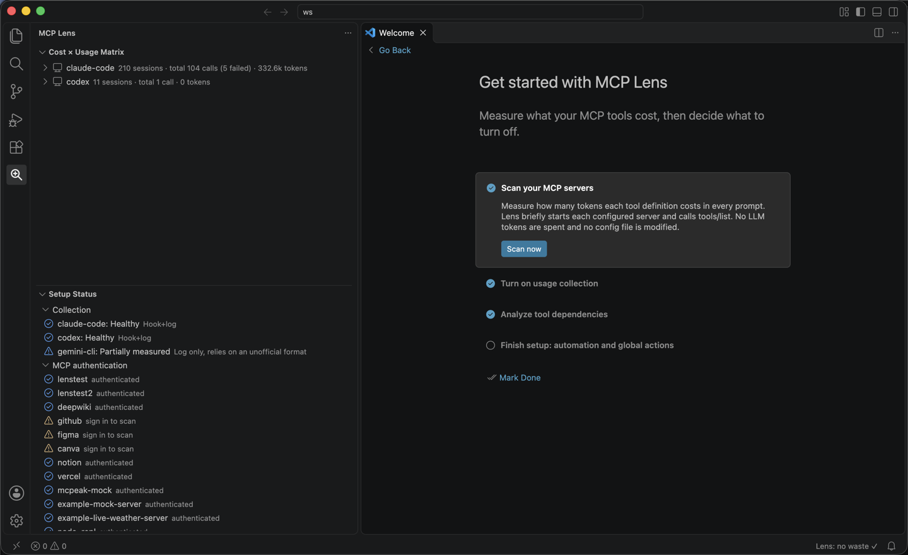
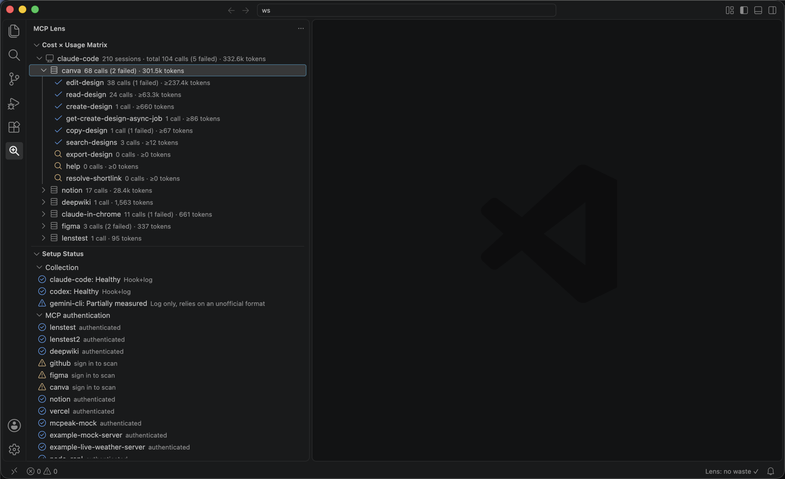
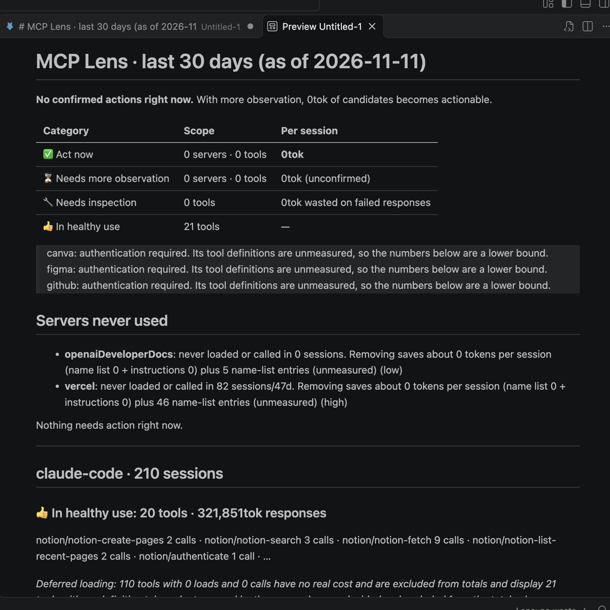

# MCP Lens

A local accounting tool that contrasts **how much context the MCP servers attached to your AI coding
client eat on every prompt** with **which of it you actually use**.

Attach one MCP server and every tool definition it has rides along in the prompt of every
conversation. Keep a 40-tool server attached and use 2 of them, and you pay the definition tokens of
the other 38 every time. MCP Lens puts the tokens the definitions cost (the cost) next to the real
call counts (the usage) and states in numbers "what do I turn off and how much is left". The basis
is the definition sizes really scanned and the call records really observed, not guesswork.

Install the VS Code extension from the Marketplace:
**[MCP Token Lens](https://marketplace.visualstudio.com/items?itemName=seodduu.mcplens)**
(or run `code --install-extension seodduu.mcplens`).

For installation, per-client hook setup, the CLI reference and the FAQ, see the documentation site:
**https://seodduu.github.io/MCPLens/**

## Screenshots

The VS Code extension (**MCP Token Lens**) shows the cost × usage matrix in the activity bar and
walks you through setup on first launch.



Each client ▸ server ▸ tool row puts calls, failed calls and tokens side by side, most expensive
first.



**MCP Lens: Show Report** turns the same data into a Markdown report: servers never used, tools that
only fail, and what removing them would save per session.



## Supported clients

| Client | Usage collection | Definition scan | Global actions (turning tools off in the config) |
|---|---|---|---|
| Claude Code | yes (plugin hooks) | yes | yes |
| Codex | yes (plugin hooks) | yes | yes |
| Gemini CLI | yes (extension hooks) | yes | no |

## Requirements

- Node.js 20 or later
- VS Code 1.90 or later (when using the extension)

The CLI takes a writer lease before it writes to `~/.mcplens/lens.db`, so a second writer (for
example the VS Code extension holding the lease) is refused cleanly instead of silently overwritten.
Still, avoid running the CLI and the extension against the database at the same time.

## Development

```bash
npm install
npm run build
npm test                # vitest (packages/*/test/**/*.test.ts)
npx tsc --noEmit -p packages/core/tsconfig.json      # always typecheck per package with -p
```

The root tsconfig uses a references layout, so running `npx tsc --noEmit` with no argument checks
zero files and succeeds. That is a false green: always name the package with `-p`.

## Documentation

- [VS Code Marketplace](https://marketplace.visualstudio.com/items?itemName=seodduu.mcplens): the MCP Token Lens extension
- [Documentation site](https://seodduu.github.io/MCPLens/): installation, per-client hook setup, CLI reference, FAQ

## License

MIT. See [`LICENSE`](LICENSE).
