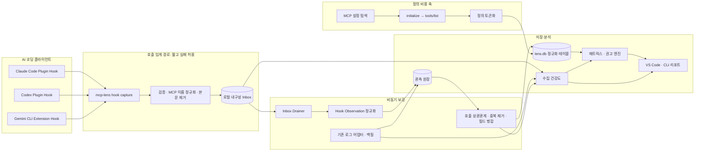
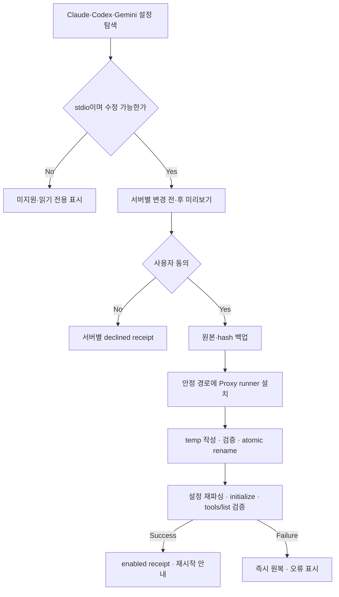
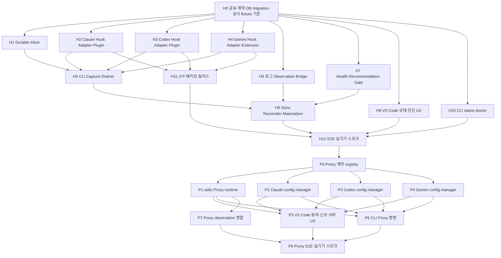

# MCP Lens 공식 Hook 우선 수집 설계

> 상태: 설계 승인안. 구현 전 상세 계획의 기준 문서다.
> 기존 기준: `MCP-Lens-설계문서-v2.md`, `docs/plans/2026-07-19-mcp-lens-mvp-구현계획.md`
> 이 문서는 기존 사용 축을 교체·보강하는 설계이며, 구현 계획이 갱신되기 전까지 기존 계획의 완료 태스크를 소급 변경하지 않는다.

## 1. 결정 요약

MCP Lens의 신규 사용량 수집 기본 경로를 **공식 lifecycle Hook**으로 전환한다.

- Claude Code: `SessionStart`, `PreToolUse`, `PostToolUse`, `PostToolUseFailure`, `SessionEnd`
- Codex: `SessionStart`, `PreToolUse`, `PostToolUse`, `Stop`
- Gemini CLI: `SessionStart`, `BeforeTool`, `AfterTool`, `SessionEnd`
- Hook은 호출 횟수, 세션 귀속, 도구 이름, 성공·실패를 직접 수집한다.
- 기존 로그 어댑터는 토큰 상세, 지연 로드 신호, 과거 세션 백필을 담당한다.
- `tools/list` 스캐너는 도구 정의와 정의 토큰을 담당하며 그대로 유지한다.
- MCP Proxy는 기본 경로가 아니라 **사용자가 서버별로 명시 동의했을 때만** 적용하는 선택 기능으로 둔다.
- 기존 MCP 서버와 새로 등록된 MCP 서버 모두 Proxy 적용 전에 변경 내용을 보여주고 승인을 받는다.

핵심 원칙은 다음과 같다.

> MCP Lens의 수집기가 고장 나도 사용자의 MCP 호출은 계속되어야 한다.

따라서 Hook 프로세스는 SQLite를 직접 열거나 네트워크 요청을 하지 않는다. 최소 메타데이터를 로컬 내구성 큐에 기록하고 즉시 성공 응답을 반환한다.

## 2. 문제 정의

현재 구현은 Claude Code, Codex, Gemini CLI의 내부 세션 파일을 직접 찾고 파싱한다.

```text
클라이언트 내부 로그
  → 경로 탐색
  → 클라이언트별 비공식 포맷 파싱
  → 정규화
  → SQLite
```

이 방식에는 세 가지 구조적 위험이 있다.

1. 클라이언트 업데이트로 로그 경로나 파일명이 바뀌면 파일을 발견하지 못한다.
2. JSON/JSONL 필드 구조가 바뀌면 파싱 결과가 0건이 되거나 잘못 집계될 수 있다.
3. 현재 워처는 실제 byte-tail이 아니라 mtime 변경 시 파일 전체를 재파싱하므로 큰 세션에서 비용이 증가한다.

특히 “파일은 발견했지만 파서가 조용히 0건을 반환하는 상황”은 시스템이 정상처럼 보이면서 잘못된 제거 권고를 만들 수 있어 가장 위험하다.

## 3. 목표와 비목표

### 3.1 목표

- 내부 로그 형식이 변경돼도 실제 MCP 호출 횟수와 세션 귀속을 유지한다.
- Hook 실패가 사용자의 MCP 호출 실패로 전파되지 않게 한다.
- 세 클라이언트를 동일한 정규화 계약으로 수집한다.
- Hook과 로그에서 같은 호출을 관찰해도 한 번만 집계한다.
- Hook·로그·스캐너 각각의 건강 상태를 사용자에게 보여준다.
- 수집 품질이 낮을 때 공격적인 제거 권고를 자동으로 낮추거나 중지한다.
- 클라이언트 공식 플러그인·확장 배포 경로를 사용해 설정 파일 직접 수정을 최소화한다.
- Proxy 선택 시 사용자가 설정 파일을 직접 편집하지 않아도 설치·검증·원복이 가능하게 한다.
- 새 MCP 서버 등록을 감지하면 아직 결정하지 않은 서버에 한해 Proxy 적용 여부를 한 번 묻는다.

### 3.2 비목표

- Hook만으로 모델의 정확한 전체 토큰 사용량을 계산하지 않는다.
- MCP 요청·응답 본문이나 사용자 프롬프트를 장기 저장하지 않는다.
- 모든 MCP 트래픽을 강제로 Proxy에 통과시키지 않는다.
- 클라우드 수집 서버나 사용자 계정 시스템을 추가하지 않는다.
- 최초 구현에서 원격 팀 단위 중앙 관제 기능을 만들지 않는다.

## 4. 검토한 접근

| 접근 | 장점 | 단점 | 결정 |
|---|---|---|---|
| 로그 우선 유지 | 기존 코드 재사용, 과거 기록과 토큰 상세 확보 | 내부 포맷 변경에 취약, 세션 경로 추측 필요 | 보조 경로로 유지 |
| Proxy 우선 | 표준 MCP 원문과 지연시간을 직접 관찰 | 모든 서버 설정 변경, 전송·인증 호환 책임, Proxy 장애가 호출 장애가 됨 | 선택 기능 |
| **Hook 우선 + 로그 보강** | 공식 이벤트, 세션 식별, 낮은 장애 영향, 클라이언트 단위 설치 | 클라이언트별 Hook 스키마 어댑터 필요, 과거 백필 불가 | **채택** |

공식 문서 기준으로 Claude Code는 플러그인에 Hook을 동봉할 수 있고, Codex는 lifecycle Hook과 플러그인 동봉 Hook을 지원한다. Gemini CLI도 현재 `hooks/hooks.json`을 포함하는 확장을 지원한다.

- Claude Code: <https://code.claude.com/docs/en/hooks>
- Codex: <https://learn.chatgpt.com/docs/hooks>
- Gemini CLI: <https://geminicli.com/docs/hooks/reference/>
- Gemini CLI 확장: <https://geminicli.com/docs/extensions/reference/>

따라서 기존 설계문서의 “Gemini CLI lifecycle Hook 없음” 전제는 이 설계로 폐기한다.

## 5. 전체 아키텍처



### 5.1 데이터 축

| 축 | 출처 | 책임 | 없어졌을 때 |
|---|---|---|---|
| 실제 사용 축 | 공식 Hook | 호출 횟수, 세션, 도구, 성공·실패 | 사용량 신규 수집 중단 |
| 상세 보강 축 | 내부 로그 | 토큰, 응답 크기, 지연 로드, 과거 백필 | 호출 수는 유지, 상세 정확도 하락 |
| 정의 비용 축 | `tools/list` | 전체 도구 목록, 정의 토큰 | 비용 계산과 제거 효과 계산 불가 |
| 검증 축 | 선택적 Proxy | 원시 MCP 요청·응답, 지연시간 | 일반 기능 영향 없음 |

Proxy가 활성화된 서버만 실제 호출 경로가 다음처럼 바뀐다.

```text
클라이언트 → MCP Lens Proxy → 원래 MCP 서버
```

Proxy가 비활성화된 서버는 기존처럼 클라이언트가 MCP 서버에 직접 연결한다.

## 6. Hook 임계 경로

### 6.1 실행 순서

```text
클라이언트 Hook 발화
  → stdin JSON 최대 크기 검사
  → 클라이언트·이벤트 이름 검사
  → MCP 도구 이름 정규화
  → 입력·응답 본문 폐기
  → 최소 Observation 생성
  → temp 파일 작성
  → pending 디렉토리로 atomic rename
  → 클라이언트별 정상 JSON 출력 후 exit 0
```

### 6.2 금지 사항

Hook 프로세스에서는 다음을 하지 않는다.

- `lens.db` 열기 또는 저장
- MCP 서버 연결
- 네트워크 요청
- 전체 transcript 읽기
- 응답 본문 토크나이즈
- 오래 걸리는 설정 탐색
- 정책 목적의 tool 차단

관측용 Hook은 정책 Hook과 분리한다. MCP Lens Hook은 어떤 입력에서도 도구 호출을 거부하는 결정을 반환하지 않는다.

### 6.3 성능 예산

- 로컬 정상 경로 p95: 250ms 이하
- 입력 상한: 1MiB; 초과 시 본문을 읽지 않고 메타 오류만 기록
- 큐 파일 하나: 16KiB 이하
- Hook timeout: 클라이언트가 허용하는 범위에서 2초 이하
- stdout: 클라이언트가 요구하는 단일 정상 JSON만 출력
- 진단 로그: stderr 또는 고정 크기 로컬 오류 로그만 사용

## 7. 로컬 내구성 Inbox

기본 경로는 `os.homedir()`와 `path.join()`으로 조립한다.

```text
~/.mcplens/
  inbox/
    pending/       # 아직 DB에 반영되지 않은 이벤트
    processed/     # 반영 완료, 7일 보존
    quarantine/    # 페이로드 없이 오류 메타데이터만 보존
  hook-errors.ndjson
  lens.db
```

이벤트 파일은 직접 덮어쓰지 않는다.

1. 동일 디렉토리에 고유한 임시 파일을 만든다.
2. 내용을 쓰고 파일을 닫는다.
3. `pending/<event-id>.json`으로 rename한다.
4. Drainer는 DB commit 후에만 `processed/`로 이동한다.

Hook 이벤트마다 프로세스가 별도로 실행될 수 있으므로 SQLite 직접 쓰기보다 파일 단위 Inbox가 안전하다. 여러 터미널·세션이 동시에 기록해도 파일명이 충돌하지 않으며, 확장 프로그램이 꺼져 있어도 이벤트가 남는다.

## 8. 정규화 계약

Hook 페이로드 원문을 저장하지 않고 아래 최소 계약으로 바꾼다.

```ts
type ObservationSource = 'hook' | 'log' | 'proxy';

type HookPhase =
  | 'session-start'
  | 'tool-before'
  | 'tool-after'
  | 'tool-failure'
  | 'turn-stop'
  | 'session-end';

interface ToolObservation {
  observationId: string;
  schemaVersion: 1;
  source: ObservationSource;
  client: ClientId;
  phase: HookPhase;
  externalSessionId: string;
  externalTurnId: string | null;
  externalCallId: string | null;
  transcriptPath: string | null;
  serverName: string | null;
  toolName: string | null;
  observedAt: string;
  durationMs: number | null;
  isError: boolean | null;
  inputFingerprint: string | null;
}
```

`tool-before`는 상관관계를 위한 pending 증거일 뿐 호출 수에 포함하지 않는다. 호출 횟수는
`tool-after` 또는 `tool-failure`가 도착했을 때만 증가한다. 세션 종료 이벤트는 클라이언트가
비정상 종료되면 누락될 수 있으므로 정확성의 필수 조건으로 사용하지 않는다.

### 8.1 개인정보·비밀정보 처리

- `tool_input`, `tool_response`, 프롬프트 본문은 저장하지 않는다.
- 상관관계가 필요하면 정규화된 입력의 SHA-256만 `inputFingerprint`로 저장한다.
- `transcriptPath`는 로컬 파서 대상 지정 용도로만 사용하며 외부로 전송하지 않는다.
- `transcriptPath`는 `realpath`로 정규화한 뒤 해당 클라이언트의 알려진 로그 루트 내부에
  있는 일반 파일일 때만 읽는다. Hook 입력으로 임의 파일을 읽게 만들지 않는다.
- 알 수 없는 필드는 무시해 forward compatibility를 확보한다.
- 필수 필드가 없으면 원문을 저장하지 않고 오류 코드와 클라이언트 버전만 기록한다.
- Inbox 디렉토리는 사용자 전용 권한, 이벤트 파일은 소유자 읽기·쓰기 전용 권한으로 만든다.

## 9. 클라이언트별 어댑터

| 클라이언트 | MCP 이름 규칙 | 기본 상관관계 키 | 설치 단위 |
|---|---|---|---|
| Claude Code | `mcp__<server>__<tool>` | 공식 tool-use ID, 없으면 turn+tool+fingerprint | 기존 `lens-audit-plugin`에 Hook 동봉 |
| Codex | `mcp__<server>__<tool>` | 공식 call/tool ID, 없으면 turn+tool+fingerprint | 별도 Codex plugin |
| Gemini CLI | `mcp_<server>_<tool>` 및 `mcp_context` | 공식 tool call ID, 없으면 session+tool+fingerprint | Gemini CLI extension |

서버·도구 이름 분리가 모호하면 임의로 잘라 확정하지 않는다. `serverName=null`로 보존한 뒤 현재 `tools/list` 정의 목록과 조인해 유일할 때만 확정한다.

## 10. Hook·로그 병합과 중복 제거

### 10.1 관측 원장과 정규화 테이블 분리

현재 `store.ingest()`는 세션 로그를 재파싱할 때 해당 세션의 자식 행을 삭제 후 다시 넣는다. Hook 행까지 같은 테이블에 직접 넣으면 로그 재파싱이 Hook 증거를 지울 수 있다.

이를 막기 위해 다음 두 층을 둔다.

```text
hook/log 관측 원장
  → session materializer
  → 기존 sessions/tool_calls/tool_loads/token_usage
  → 분석 엔진
```

- 관측 원장은 출처별 원본 정규화 이벤트를 멱등 저장한다.
- 로그 파일 재파싱은 해당 `source_revision`의 로그 관측만 교체한다.
- Hook 관측은 로그 재파싱과 독립적으로 유지한다.
- materializer가 한 세션의 관측을 다시 계산해 기존 분석 테이블을 갱신한다.

### 10.2 중복 제거 우선순위

1. `externalCallId`가 같으면 같은 호출이다.
2. ID가 없으면 `client + session + turn + tool + inputFingerprint`를 사용한다.
3. fingerprint도 없으면 같은 phase의 시간 근접 이벤트를 후보로 묶되 `correlationConfidence=low`로 기록한다.
4. Hook과 로그가 충돌하면 호출 존재 여부와 세션 귀속은 Hook을 우선한다.
5. 토큰·로드 정보는 로그를 우선하고 Hook에 없는 필드를 보강한다.
6. 오류 여부가 충돌하면 실패 증거를 보수적으로 유지하고 건강도 경고를 만든다.

### 10.3 필드별 출처 우선순위

| 필드 | 1순위 | 2순위 |
|---|---|---|
| 세션·턴·호출 발생 | Hook | 로그 |
| 서버·도구 이름 | 공식 Hook 필드 | 로그 + 정의 조인 |
| 성공·실패 | Post/After Hook | 로그 |
| duration | 구조화 Hook 값 | 로그 |
| 응답 토큰 | 클라이언트 실측 로그 | 응답 본문 추정 |
| 지연 로드 토큰 | 실측 로그 | `tools/list` 정의 조인 |
| 정의 토큰 | `tools/list` | 없음 |

## 11. 수집 건강도와 안전장치

회계 모드와 수집 품질을 분리한다. `UPFRONT`/`DEFERRED_*`는 비용 부과 방식을 의미하고, 아래 상태는 관측 신뢰도를 의미한다.

```ts
type CollectionHealth =
  | 'idle'
  | 'healthy'
  | 'hook-only'
  | 'log-only'
  | 'degraded'
  | 'unavailable';
```

### 11.1 상태 판정

| 상태 | 판정 |
|---|---|
| `idle` | 최근 MCP 실행·로그 변화가 없어 Hook 건강도를 판정할 근거가 없음 |
| `healthy` | 최근 완료 세션에서 Hook과 로그가 모두 보이고 호출 수 불일치가 5% 이하 |
| `hook-only` | Hook은 정상이나 로그가 없거나 파싱 불가 |
| `log-only` | 로그는 수집되나 Hook이 설치되지 않았거나 아직 발화하지 않음 |
| `degraded` | 3개 완료 세션 연속 불일치 5% 초과, 필수 Hook 필드 누락, parseErrors 급증 |
| `unavailable` | Hook과 로그 모두 관측되지 않음 |

시간이 지났다는 이유만으로 `degraded`나 `unavailable`로 바꾸지 않는다. 로그에서 eligible MCP
호출을 발견했는데 대응 Hook이 10초의 correlation grace 후에도 없을 때 miss로 센다. 3회 연속
miss면 `degraded`, 이후 2회 연속 정상 상관관계가 확인되면 `healthy`로 복구한다.

### 11.2 권고 게이트

- `healthy`: 현재 권고 로직을 사용한다.
- `hook-only`: 호출 수·실패율은 사용하되 토큰 상세는 `측정 불가`로 표시한다.
- `log-only`: 기존 로그 기반 결과를 표시하되 “비공식 포맷 의존” 경고를 붙인다.
- `degraded`: `remove`와 `filter-server`를 확정 권고로 표시하지 않고 후보로 강등한다.
- `unavailable`: 사용량 기반 권고를 만들지 않는다.
- `tools/list`가 실패하면 사용량이 있어도 정의 비용·절감량을 확정하지 않는다.

이 게이트가 로그 포맷 변경으로 호출 수가 갑자기 0이 됐을 때 “모든 도구 삭제” 같은 잘못된 결론을 방지한다.

## 12. 배포와 설치

하나의 Git 태그에서 다음 산출물을 같은 버전으로 배포한다.

| 산출물 | 역할 | 설치 방식 |
|---|---|---|
| VS Code Extension | 대시보드, Drainer, 상태·권고 UI | VSIX/Marketplace |
| `@mcp-lens/cli` | 리포트, 스캔, Hook capture/status/doctor | npm/npx |
| Claude Code plugin | `/lens-audit` + 공식 Hook | Claude plugin marketplace |
| Codex plugin | 공식 lifecycle Hook | Codex plugin marketplace/로컬 설치 |
| Gemini CLI extension | 공식 lifecycle Hook | `gemini extensions install` |

설정 파일에 Hook JSON을 직접 병합하는 자동 설치는 기본 제공하지 않는다. 공식 패키지 설치·활성화·신뢰 UI를 사용한다. 사용자는 Hook 정의를 검토하고 승인할 수 있어야 한다.

각 플러그인·확장에는 self-contained Hook runner를 동봉한다. 매 도구 호출마다 `npx`로 패키지를
찾거나 내려받지 않으며, 플러그인 설치 경로에서 바로 실행한다. 런타임 버전은 세 배포 산출물과
동일한 MCP Lens 릴리스 버전으로 고정한다.

### 12.1 진단 명령

```text
mcp-lens hooks status   # 설치 감지, 마지막 이벤트, 큐 적체, 건강도
mcp-lens hooks doctor   # 샘플 이벤트 왕복, 권한, 경로, 스키마 검사
mcp-lens hook capture   # 플러그인 전용 내부 명령; 일반 사용자 문서에서는 숨김
```

VS Code 사이드바에는 클라이언트별로 다음을 표시한다.

```text
Claude Code   ● 정상      Hook+로그 · 2분 전
Codex         ◐ 부분 측정 Hook only · 토큰 상세 없음
Gemini CLI    ○ 미연결    확장 설치 필요
```

### 12.2 Proxy 동의 원칙

VS Code 확장 설치만으로 기존 MCP 설정을 조용히 변경하지 않는다. Hook+로그 수집은 기본으로
동작하고 Proxy는 별도 선택 화면에서 사용자가 승인한 서버에만 적용한다.

최초 Proxy 안내는 설치된 클라이언트와 발견된 eligible stdio 서버를 한 화면에 보여준다.

```text
MCP Lens가 stdio MCP 서버 4개를 발견했습니다.

Proxy를 연결하면 요청·응답 크기, 실제 지연시간, 서버 오류를 추가 측정합니다.
Proxy 장애 시 해당 MCP 서버 호출이 영향을 받을 수 있습니다.
데이터는 기본적으로 이 기기 밖으로 전송되지 않습니다.

☑ Claude Code / github
☑ Codex / filesystem
☐ Gemini CLI / postgres

[선택한 서버에 연결] [기본 수집만 사용]
```

동의 단위는 전역이 아니라 `client + config scope + server`다. 사용자가 여러 서버를 한 번에
선택할 수는 있지만, 내부적으로는 서버별 receipt를 각각 보존한다.

### 12.3 Proxy 사용자 정책

```ts
type ProxyPromptPolicy =
  | 'ask-new'   // 기본값: 새 eligible 서버마다 한 번 질문
  | 'never';    // Proxy 안내를 표시하지 않음
```

- 기본값은 `ask-new`다.
- 최초 안내에서 `기본 수집만 사용`을 선택해도 새 서버 질문 정책은 별도로 `ask-new`를 유지한다.
- 사용자가 “앞으로 묻지 않음”을 선택하면 `never`로 바꾼다.
- 새 서버 자동 wrapping은 제공하지 않는다. `ask-new`에서도 서버별 확인 후에만 설정을 변경한다.
- 관리 정책 또는 읽기 전용 설정은 정책과 관계없이 자동 변경하지 않는다.

### 12.4 기존 서버 Proxy 적용 흐름



설정에서 VS Code 확장 버전 디렉토리를 직접 참조하지 않는다. 업데이트에도 유지되는 다음 경로에
self-contained runner를 설치한다.

```text
~/.mcplens/bin/mcp-lens-proxy
```

runner는 임시 파일에 설치한 뒤 checksum과 실행 권한을 검증하고 atomic rename으로 교체한다.

### 12.5 새 MCP 등록 감지와 질문

기존 자동 스캐너가 감시하는 Claude·Codex·Gemini MCP 설정 변경 이벤트를 재사용한다.

```text
설정 파일 add/change
  → 2초 debounce
  → 모든 config source 재수집
  → 이전 server identity snapshot과 비교
  → 신규 서버인지 판정
  → tools/list 비용 스캔
  → Proxy 정책 확인
  → 아직 결정하지 않은 eligible 서버만 질문
```

새 서버 질문 예시는 다음과 같다.

```text
새 MCP 서버가 등록되었습니다.

Codex / github
실행: npx -y @modelcontextprotocol/server-github
전송: stdio

MCP Lens Proxy를 연결해 호출 지연과 서버 오류를 측정할까요?

[Proxy 연결] [이번에는 건너뜀] [이 서버는 다시 묻지 않음]
```

선택 의미:

| 선택 | 저장 상태 | 다음 설정 변경 시 |
|---|---|---|
| `Proxy 연결` | `enabled` | 설정 drift만 검사, 다시 묻지 않음 |
| `이번에는 건너뜀` | `deferred` | 서버 실행 정의가 바뀌거나 30일 뒤 다시 질문 가능 |
| `이 서버는 다시 묻지 않음` | `declined` | 사용자가 설정 화면에서 초기화하기 전까지 질문하지 않음 |

MCP Lens가 Proxy를 삽입해 발생한 설정 변경은 신규 서버 등록으로 다시 판단하지 않는다. config
source, scope, server name, 원래 command/url fingerprint로 `serverIdentity`를 만들고 receipt와 비교한다.

### 12.6 설정 변경과 원복 계약

Proxy registry는 다음 정보를 `~/.mcplens/proxy-registry.json`에 저장한다.

```ts
interface ProxyRegistration {
  serverIdentity: string;
  client: ClientId;
  configPath: string;
  configScope: 'user' | 'project' | 'local' | 'managed';
  serverName: string;
  transport: 'stdio';
  decision: 'enabled' | 'deferred' | 'declined' | 'drifted';
  originalDefinition: unknown;
  originalHash: string;
  installedHash: string | null;
  decidedAt: string;
  lastVerifiedAt: string | null;
}
```

- 수정 전에 원본 정의와 파일 hash를 저장한다.
- temp 파일 작성 후 JSON/TOML 파싱 검증을 통과해야 원본 경로로 rename한다.
- `env`, `cwd`, timeout과 클라이언트별 추가 필드는 그대로 보존한다.
- 프로젝트 공유 설정은 “Git에 포함될 수 있음”을 추가 경고하고 별도 승인받는다.
- managed/system 설정은 읽기 전용으로 표시한다.
- 제거 시 현재 정의가 `installedHash`와 같을 때만 자동 원복한다.
- 사용자가 설치 후 설정을 수정했다면 `drifted`로 표시하고 자동 덮어쓰지 않는다.
- MCP Lens가 소유하지 않은 다른 Hook·MCP 서버 설정은 변경하지 않는다.

### 12.7 Proxy v1 지원 범위

첫 구현은 stdio MCP 서버만 지원한다.

```text
client stdin/stdout
  ↔ mcp-lens-proxy
  ↔ child MCP server stdin/stdout
```

Proxy는 JSON-RPC 메시지를 순서와 내용 변경 없이 전달하면서 `initialize`, `tools/list`,
`tools/call`, 성공·오류, 왕복시간 메타데이터만 관측 원장에 기록한다. 요청 인자와 응답 본문은
기본 저장하지 않는다.

HTTP/SSE/Streamable HTTP 서버는 로컬 daemon, 포트, 인증 헤더, OAuth, 재연결, 취소 전파가
필요하므로 v1에서 설정을 변경하지 않고 `HTTP Proxy 미지원`으로 표시한다.

### 12.8 Remote·Web 환경

- Proxy는 AI 클라이언트와 MCP 서버가 실제 실행되는 머신에 설치한다.
- Remote SSH, Dev Container, WSL에서는 로컬·원격 설정을 구분해 보여준다.
- VS Code Web에서는 실행 파일 설치와 child process 실행이 불가능하므로 Proxy 설치 버튼을 숨긴다.
- 실행 위치를 확정할 수 없으면 설정을 변경하지 않고 CLI 설치 명령만 안내한다.
- Proxy 연결 후 해당 클라이언트의 새 세션 또는 재시작이 필요함을 명시한다.

### 12.9 Proxy 진단·해제 명령

```text
mcp-lens proxy status [--json]
mcp-lens proxy enable <client> <server>
mcp-lens proxy disable <client> <server>
mcp-lens proxy doctor <client> <server>
mcp-lens proxy policy ask-new|never
```

VS Code의 Proxy 상태는 Hook 수집 상태와 분리해 표시한다.

```text
Codex / github
  Hook       ● 정상
  Log        ● 정상
  Proxy      ● 연결 · stdio · 32초 전
  Config     ● 원본 백업 보유
```

## 13. 실패 처리

| 실패 | 동작 | 사용자 영향 |
|---|---|---|
| Hook 입력 JSON 파손 | 원문 폐기, 오류 메타만 기록, 정상 응답 | MCP 호출 계속 |
| Inbox 쓰기 실패 | stderr 진단, 정상 응답, 다음 health check에서 stale 감지 | 해당 이벤트 누락 가능 |
| Drainer 중단 | pending 유지, 다음 시작 때 재처리 | 화면 갱신 지연 |
| 동일 이벤트 재전달 | `observationId` unique로 무시 | 중복 집계 없음 |
| 로그 경로 변경 | Hook usage 유지, 로그 어댑터 degraded | 토큰·로드 상세 하락 |
| 로그 스키마 변경 | parseErrors·불일치 경고, Hook 기준 호출 유지 | 제거 권고 강등 |
| Hook 스키마 변경 | 허용 필드는 계속 파싱, 필수 필드 누락 시 degraded | 원문/비밀정보 저장 없음 |
| `tools/list` 실패 | 기존 snapshot 유지하되 stale 표시 | 절감량 확정 중지 |
| DB commit 실패 | pending을 processed로 이동하지 않음 | 재시작 후 재처리 |
| Proxy runner 설치 실패 | 설정 변경 전 중단 | 기존 MCP 호출 유지 |
| Proxy 설정 검증 실패 | 백업으로 즉시 원복 | 재시작 전 오류 안내 |
| Proxy child process 실패 | 원래 stderr·MCP 오류 전달, health degraded | 해당 서버 호출 실패 가능 |
| Proxy 설정 drift | 자동 수정·원복 중지, diff 표시 | 사용자 설정 보존 |
| 새 서버 반복 감지 | serverIdentity receipt로 prompt dedupe | 중복 질문 없음 |

## 14. 테스트 전략

### 14.1 유닛 테스트

- 세 클라이언트 공식 Hook fixture → 동일 `ToolObservation` 계약
- MCP 도구와 내장 도구 필터링
- 입력·응답 본문이 큐 파일에 남지 않는지 검사
- temp→rename 원자 기록과 동일 event ID 멱등성
- call ID 및 fallback fingerprint 상관관계
- Hook/로그 필드 우선순위
- 건강도 상태 전이와 권고 게이트
- Proxy 설정 변환 시 원본 필드 보존과 이중 wrapping 방지
- 신규 서버 prompt receipt의 `enabled/deferred/declined` 전이
- drift 상태에서 자동 원복하지 않는지 검사

### 14.2 계약 테스트

- 각 클라이언트 최소 지원 버전의 실제 Hook 출력 fixture를 저장한다.
- fixture에는 클라이언트 버전, Hook 이벤트 이름, 필수 필드를 명시한다.
- 새 클라이언트 버전 fixture를 추가할 때 기존 fixture도 계속 통과해야 한다.
- 알 수 없는 필드 추가는 허용하고 필수 필드 제거는 명시적으로 실패시킨다.

### 14.3 통합 테스트

```text
Hook fixture
  → capture CLI
  → pending 파일
  → Drainer
  → observation store
  → log fixture 병합
  → materialized tool_calls
  → matrix/report
```

검증 항목은 다음과 같다.

- Hook 1건 + 로그 1건이 호출 1건으로 계산된다.
- Hook만 있어도 호출 수와 실패 여부가 표시된다.
- 로그만 있어도 기존 동작이 유지된다.
- 깨진 로그를 넣어도 Hook 호출 수가 사라지지 않는다.
- DB 실패 후 재시작하면 pending 이벤트가 다시 처리된다.
- 새 stdio 서버 등록 시 `ask-new` 정책에서 한 번만 질문 대상이 된다.
- Proxy를 적용한 설정 변경이 다시 신규 서버로 감지되지 않는다.
- Proxy disable 시 원본 정의가 정확히 복구된다.
- 사용자가 수정한 설정은 disable이 덮어쓰지 않고 drift로 보고한다.

### 14.4 실기기 스모크

실제 Claude Code, Codex, Gemini CLI와 하나의 더미 MCP 서버를 사용한다. 세 클라이언트는 동일 서버를 순차 실행하며 공유 `~/.mcplens/lens.db`와 더미 서버 포트를 동시에 사용하지 않는다.

1. `tools/list` 도구 2개 확인
2. 성공 호출 1회, 실패 호출 1회
3. Hook 이벤트 2회와 canonical 호출 2건 확인
4. 로그 보강 후에도 canonical 호출이 2건인지 확인
5. Hook 플러그인 비활성화 후 `log-only` 전환 확인
6. 로그 fixture를 깨뜨린 뒤 `hook-only` 또는 `degraded` 전환 확인
7. stdio 서버 Proxy 동의 → 설정 wrapping → 성공·실패 호출 관측
8. 새 stdio 서버 등록 → 1회 질문 → 연결 또는 declined receipt 확인
9. Proxy 제거 → 원본 설정 복구와 다른 설정 무손실 확인

## 15. 멀티터미널·서브에이전트 실행 설계

### 15.1 공통 실행 모델

```text
터미널 1개 = worktree 1개 = 브랜치 1개 = 파일 소유권 1개
  └─ 터미널의 Codex 세션 = 오케스트레이터
       ├─ 구현 서브에이전트: 해당 Task만 수정
       ├─ 명세 리뷰 서브에이전트: 요구사항·소유권 검증
       └─ 품질 리뷰 서브에이전트: 테스트·회귀 검증
```

- 독립 Task는 최대 4개 터미널에서 병렬 실행한다.
- 한 Task 안에서는 fresh 구현 서브에이전트와 리뷰 서브에이전트를 분리한다.
- 공유 계약 파일은 통합 터미널만 수정한다.
- 각 Task는 자기 테스트를 통과하고 커밋한 뒤 완료로 본다.
- Wave 종료 시 통합 터미널이 브랜치를 하나씩 머지하고 전체 테스트를 실행한다.
- 실기기 DB·실제 MCP 서버·고정 포트를 쓰는 테스트는 병렬 실행하지 않는다.

### 15.2 공유 파일 잠금

다음 파일은 병렬 터미널에서 수정하지 않는다.

```text
package.json
tsconfig.base.json
vitest.config.ts
packages/core/src/types.ts
packages/core/src/index.ts
packages/core/src/store/schema.sql
packages/cli/src/main.ts
packages/extension/src/extension.ts
```

이 파일은 각 Wave의 통합 Task에서만 수정한다. 개별 Task가 계약 변경이 필요하다고 판단하면 직접 수정하지 않고 오케스트레이터에게 변경 요청을 보고한다.

### 15.3 의존성 그래프



### 15.4 Wave별 터미널 배치

| Wave | 터미널 | Task | 브랜치 | 완료 기준 |
|---|---:|---|---|---|
| 0 | 1 | H0 공유 계약 고정 | `feat/hook-contract` | 타입·migration·계약 테스트 통과 |
| 1 | 4 | H1 Inbox / H2 Claude / H3 Codex / H4 Gemini | `feat/hook-inbox`, `feat/hook-claude`, `feat/hook-codex`, `feat/hook-gemini` | 각 전용 테스트 통과, 공유 파일 무수정 |
| 2 | 4 | H5 Capture·Drainer / H6 로그 Bridge / H7 Health / H11 패키징 골격 | `feat/hook-capture`, `feat/log-observation`, `feat/collection-health`, `feat/hook-packaging` | fixture 기반 컴포넌트 테스트 통과 |
| 3 | 3 | H8 Reconciler / H9 VS Code / H10 CLI 진단 | `feat/observation-reconcile`, `feat/hook-health-ui`, `feat/hook-doctor` | Hook+로그 중복 제거 통합 테스트 통과 |
| 4 | 1 | H12 전체 통합·실기기 스모크 | `feat/hook-e2e` | 전체 build/test/smoke 및 3사 순차 검증 |
| 5 | 1 | P0 Proxy 계약·registry | `feat/proxy-contract` | identity·receipt·원복 계약 테스트 통과 |
| 6 | 4 | P1 runtime / P2 Claude / P3 Codex / P4 Gemini | `feat/proxy-runtime`, `feat/proxy-claude`, `feat/proxy-codex`, `feat/proxy-gemini` | stdio 전달·설정 변환 테스트 통과 |
| 7 | 3 | P5 VS Code UX / P6 CLI / P7 observation 병합 | `feat/proxy-consent-ui`, `feat/proxy-cli`, `feat/proxy-observation` | 동의·신규 서버·중복 제거 통합 테스트 통과 |
| 8 | 1 | P8 Proxy E2E·실기기 스모크 | `feat/proxy-e2e` | 3사 stdio 서버 적용·원복 순차 검증 |

H9와 H10은 H8의 공개 API 계약을 H0에서 고정한 뒤 mock으로 선행 구현할 수 있지만, 최종 검증은 H8 머지 후 진행한다.

### 15.5 단계적 활성화

기능을 한 번에 권고 엔진의 진실로 승격하지 않는다.

1. **Shadow 단계**: Hook 이벤트를 저장·상관관계 분석하지만 기존 권고 결과에는 반영하지 않는다.
2. **Count-primary 단계**: 실기기 상관관계 기준을 통과한 클라이언트부터 호출 수·실패 여부에 Hook을 우선한다.
3. **Health-gated 단계**: 세 클라이언트 모두에서 로그 파손 회귀 테스트가 통과하면 수집 건강도에 따른 권고 강등을 활성화한다.

단계 전환은 코드의 암묵적 조건이 아니라 명시적 feature flag와 릴리스 체크리스트로 관리한다.

### 15.6 Task별 파일 소유권

| Task | 소유 파일 | 수정 금지 핵심 |
|---|---|---|
| H0 | `packages/core/src/ingest/contracts.ts`, 공유 `types.ts`, `schema.sql`, `index.ts`, migration 테스트 | 클라이언트별 Hook 구현 |
| H1 | `packages/core/src/ingest/inbox/`, 대응 테스트 | store, CLI, extension |
| H2 | `packages/core/src/ingest/clients/claude/`, `fixtures/hooks/claude/`, `packages/lens-audit-plugin/hooks/` | 다른 클라이언트, 공유 계약 |
| H3 | `packages/core/src/ingest/clients/codex/`, `fixtures/hooks/codex/`, `packages/codex-plugin/` | 다른 클라이언트, 공유 계약 |
| H4 | `packages/core/src/ingest/clients/gemini/`, `fixtures/hooks/gemini/`, `packages/gemini-extension/` | 다른 클라이언트, 공유 계약 |
| H5 | `packages/core/src/ingest/drainer.ts`, `packages/cli/src/hook-capture.ts`, 전용 테스트 | CLI main 배선, store schema |
| H6 | `packages/core/src/ingest/log-bridge.ts`, `packages/core/src/watch/watcher.ts`, 관련 테스트 | 기존 클라이언트 파서의 무관한 리팩터링 |
| H7 | `packages/core/src/health/`, `packages/core/src/engine/healthGate.ts`, 관련 테스트 | 리포트 문구·UI |
| H8 | `packages/core/src/store/observations.ts`, `store.ts`, materializer 테스트, 공유 index 배선 | extension·CLI UI |
| H9 | `packages/extension/src/hookStatus.ts`, 상태바·트리 전용 파일, 최종 `extension.ts` 배선 | core 구현, 빌드 파일의 기존 사용자 변경 |
| H10 | `packages/cli/src/hooks-status.ts`, `hooks-doctor.ts`, 최종 `main.ts` 배선 | core 내부 구현 |
| H11 | 세 플러그인·확장 manifest, 패키징 스크립트, 배포 문서 | core·extension 기능 코드 |
| H12 | `packages/core/test/e2e/hook-pipeline.test.ts`, `docs/SMOKE.md`, 실기기 스크립트 | 기능 추가·공유 계약 변경 |
| P0 | `packages/core/src/proxy/contracts.ts`, `registry.ts`, 대응 테스트, 공유 index 배선 | runtime·UI·클라이언트 설정 변환 |
| P1 | `packages/proxy/`, stdio relay·관측 테스트 | client config·extension·CLI |
| P2 | `packages/core/src/proxy/config/claude.ts`, fixture·테스트 | 다른 클라이언트·공유 계약 |
| P3 | `packages/core/src/proxy/config/codex.ts`, fixture·테스트 | 다른 클라이언트·공유 계약 |
| P4 | `packages/core/src/proxy/config/gemini.ts`, fixture·테스트 | 다른 클라이언트·공유 계약 |
| P5 | `packages/extension/src/proxyConsent.ts`, `proxyStatus.ts`, 신규 서버 prompt 테스트, 최종 `extension.ts`·manifest 배선 | core·CLI·proxy runtime |
| P6 | `packages/cli/src/proxy-command.ts`, formatter·테스트, 최종 `main.ts` 배선 | extension·core 내부 구현 |
| P7 | `packages/core/src/proxy/observation.ts`, Hook·로그·Proxy 병합 테스트 | 설정 파일·UI |
| P8 | `packages/core/test/e2e/proxy-pipeline.test.ts`, `docs/SMOKE.md`, 실기기 스크립트 | 신규 기능·계약 변경 |

### 15.7 Task별 역할과 모델

프로젝트 `AGENTS.md`의 모델 배분을 따른다.

| Task 종류 | 서브에이전트 역할 | 모델·추론 |
|---|---|---|
| H0, H8, H12 | architect/executor/verifier | `gpt-5.6-sol`, high |
| H2, H3, H4 | client adapter executor + contract reviewer | `gpt-5.6-sol`, high |
| H1, H5, H6, H7, H9, H10, H11 | executor + verifier | `gpt-5.6-terra`, medium |
| P0, P1, P2, P3, P4, P8 | architect/adapter executor/verifier | `gpt-5.6-sol`, high |
| P5, P6, P7 | executor + verifier | `gpt-5.6-terra`, medium |
| 각 Wave 통합 | 오케스트레이터 | `gpt-5.6-sol`, high |

현재 표면이 자식별 모델 선택을 지원하지 않으면 부모 설정을 상속하고 프롬프트에 역할과 필요한 추론 수준을 명시한다.

### 15.8 터미널 프롬프트 계약

각 터미널은 아래 형식을 사용한다.

```text
이 worktree에서는 공식 Hook 우선 수집 설계의 Task HN만 수행한다.
구현 서브에이전트와 검증 서브에이전트를 분리한다.
Task의 소유 파일 밖은 수정하지 않는다.
특히 types.ts, schema.sql, index.ts, main.ts, extension.ts는 통합 Task가 아니면 수정하지 않는다.
계약이 맞지 않으면 임의 변경하지 말고 필요한 시그니처와 근거를 오케스트레이터에게 보고한다.
원본 클라이언트 로그는 읽기 전용이며 테스트는 fixture와 임시 디렉토리·:memory: DB만 사용한다.
완료 전 대상 테스트와 typecheck를 실행하고 결과를 보고한다.
```

### 15.9 머지 게이트

각 브랜치 머지 전에 통합 터미널은 다음을 확인한다.

1. Task 소유 파일 밖 변경이 없는가
2. Hook fixture에 프롬프트·토큰·경로 등 민감정보가 익명화됐는가
3. Hook 정상 응답이 tool 차단 필드를 포함하지 않는가
4. 실패 테스트를 먼저 확인한 TDD 증거가 있는가
5. 대상 테스트와 typecheck가 통과하는가
6. 공유 계약 변경이 필요하면 다음 Wave 시작 전에 단일 커밋으로 반영됐는가

## 16. 완료 조건

다음 조건을 모두 충족해야 공식 Hook 우선 전환이 완료된다.

- 세 클라이언트 공식 패키지에서 Hook이 발화한다.
- Hook 실행 중 Lens DB를 열거나 네트워크를 사용하지 않는다.
- Hook 입력의 tool input/response 본문이 Inbox와 DB에 저장되지 않는다.
- Hook-only 상태에서 실제 호출 수와 실패 여부가 표시된다.
- 로그-only 상태에서 기존 기능이 회귀하지 않는다.
- Hook+로그 상태에서 같은 호출이 중복 집계되지 않는다.
- 로그 경로·스키마 파손 시 health가 degraded로 바뀌고 제거 권고가 강등된다.
- `tools/list` 실패 시 절감량을 확정값으로 표시하지 않는다.
- 큐 적체와 마지막 Hook 수신 시간이 VS Code와 CLI에 표시된다.
- 전체 단위·통합 테스트와 3사 실기기 순차 스모크가 통과한다.
- VS Code 확장 설치만으로 MCP 설정이 변경되지 않는다.
- 기존 stdio 서버는 서버별 동의 후에만 Proxy로 wrapping된다.
- 새 stdio 서버 등록 시 `ask-new` 정책에서 한 번만 Proxy 적용 여부를 묻는다.
- `declined` 서버는 사용자가 결정을 초기화하기 전까지 다시 묻지 않는다.
- Proxy 설치·검증 실패 시 원본 설정이 자동 복구된다.
- 설정 drift가 있으면 사용자 변경을 덮어쓰지 않는다.
- Proxy disable/uninstall 후 다른 MCP·Hook 설정이 그대로 유지된다.

## 17. 후속 범위

공식 Hook 우선과 stdio Proxy 전환이 안정화된 뒤에만 아래를 별도 설계한다.

- HTTP/SSE/Streamable HTTP Proxy와 로컬 daemon lifecycle
- OpenTelemetry 수집기 연동
- 팀 단위 중앙 집계와 익명화 정책
- 클라이언트 버전별 Hook schema 자동 호환성 매트릭스
- 장기 큐 압축과 보존 정책 사용자 설정
