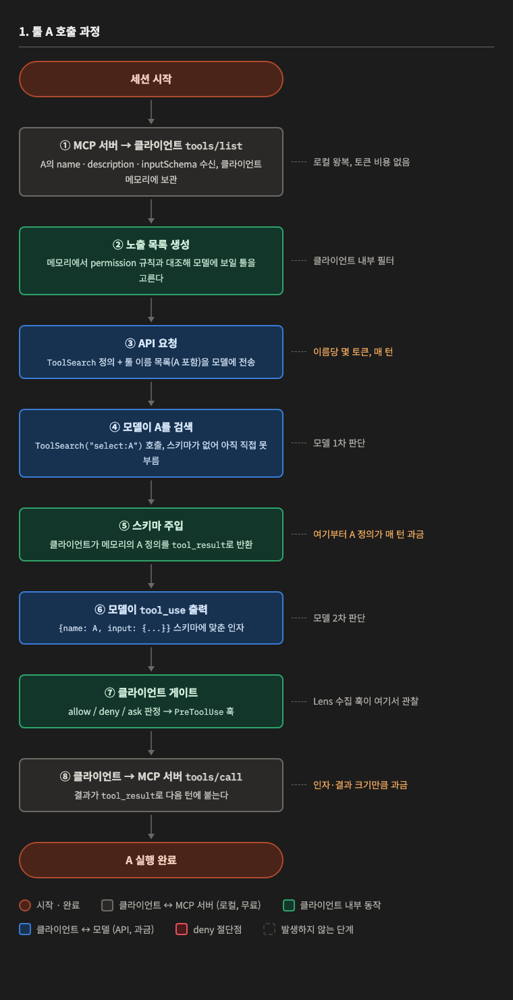
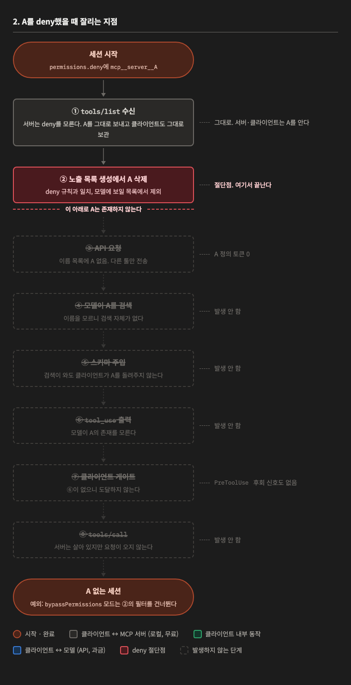

# 툴 A 호출 과정과 deny 절단점

Claude Code의 지연 로딩(deferred tools) 모드를 기준으로, MCP 툴 A가 실행되기까지 지나는 단계와
`permissions.deny`에 A를 넣었을 때 어느 단계에서 잘리는지를 정리한다. Codex·Gemini도 골격은 같고
필터 위치와 검색 형태만 다르다.

핵심 결론 두 가지.

- 정의 토큰이 과금되는 지점은 클라이언트가 **모델에게 보내는 순간**뿐이다. 서버와 클라이언트 사이의
  `tools/list`는 로컬 왕복이라 비용이 없다.
- deny는 호출 시점을 막는 게 아니라 **모델 노출 목록에서 A를 빼는** 방식이다. 서버와 클라이언트는
  A를 계속 알고, 모델부터 아래로는 A가 존재하지 않는다.

## 1. 툴 A 호출 과정

### ① `tools/list` 수신 (MCP 서버 → 클라이언트)

클라이언트가 설정된 MCP 서버 전부에 연결한다. stdio 서버면 프로세스를 spawn하고, HTTP 서버면
접속한다. 서버마다 `initialize` 다음 `tools/list`를 보내고, 페이지네이션(`nextCursor`)이 있으면
끝까지 받는다. 응답에는 툴마다 `name`, `description`, `inputSchema`(JSON Schema)가 들어 있다.

클라이언트는 이 정의 전체를 프로세스 메모리에 보관한다. 서버가
`notifications/tools/list_changed`를 보내면 다시 받는다.

이 단계는 클라이언트와 서버 사이의 로컬 JSON-RPC 왕복이다. LLM API를 거치지 않으므로 토큰 과금과
컨텍스트 점유가 없다. 드는 비용은 서버 기동 시간과 메모리뿐이다.

### ② 노출 목록 생성 (클라이언트 내부)

메모리에 보관한 정의를 permission 규칙(`allow` / `deny` / `ask`)과 대조해 모델에게 보여줄 툴을
고른다. 지연 로딩 모드에서는 여기서 고른 툴의 **이름만** 목록으로 만들고, 스키마와 설명은 메모리에
남긴다.

이 단계도 클라이언트 내부 동작이라 비용이 없다.

### ③ API 요청 (클라이언트 → 모델)

Messages API 요청의 `tools` 파라미터에 `ToolSearch` 메타 툴 정의 하나가 실리고, 시스템 프롬프트에
②에서 만든 툴 이름 목록이 텍스트로 붙는다. A는 `mcp__<server>__A` 같은 식별자 한 줄로만 존재한다.

여기서부터 과금이다. 이름당 몇 토큰이고, 매 턴 다시 보낸다(프롬프트 캐시는 되지만 컨텍스트
점유는 그대로다). 즉시 로딩 모드라면 이 단계에서 이름이 아니라 정의 전체가 실린다.

### ④ 모델이 A를 검색 (모델 → 클라이언트)

모델이 사용자 프롬프트를 보고 A가 필요하다고 판단한다. 모델은 컨텍스트에 있는 것만 알기 때문에
③의 이름 목록이 A를 아는 유일한 출처다. 스키마가 없어 A를 직접 부를 수 없으므로 대신
`ToolSearch("select:mcp__<server>__A")`를 호출한다.

키워드 검색(`"weather forecast"`)도 가능하다. 그러면 후보 여러 개가 한꺼번에 매칭된다.

### ⑤ 스키마 주입 (클라이언트 → 모델)

클라이언트가 ①에서 보관한 메모리에서 매칭된 정의를 꺼내 `tool_result`로 돌려준다. 서버에 다시
묻지 않기 때문에 즉시 응답한다.

이 시점부터 A의 정의(설명 + `inputSchema`)가 컨텍스트에 상주하고 세션이 끝날 때까지 매 턴
과금된다. 지연 로딩의 후불 비용이 여기서 발생한다. ④가 키워드 검색이었으면 실제 쓸 툴 하나 외에
같이 딸려온 후보들의 정의도 전부 과금된다.

### ⑥ `tool_use` 출력 (모델 → 클라이언트)

이제 스키마를 아는 모델이 `{name: "mcp__<server>__A", input: {...}}` 형태의 `tool_use` 블록을
출력한다. 인자는 `inputSchema`에 맞춰 만든다. 스키마 없이는 인자를 만들 수 없기 때문에 이 단계는
지연 로딩이든 즉시 로딩이든 없앨 수 없다.

### ⑦ 클라이언트 게이트 (클라이언트 내부)

클라이언트가 permission 규칙으로 allow / deny / ask를 판정하고, `PreToolUse` 훅을 실행한다.
Lens의 사용 수집 훅이 이 자리에서 호출을 관찰한다.

### ⑧ `tools/call` (클라이언트 → MCP 서버)

클라이언트가 서버에 `tools/call {name, arguments}`를 보낸다. 서버의 응답이 `tool_result`로 다음
턴의 컨텍스트에 붙는다. 인자와 결과 크기만큼 과금된다.

## 2. A를 deny했을 때 잘리는 지점

`~/.claude/settings.json`의 `permissions.deny`에 `mcp__<server>__A`가 있는 상태로 새 세션을
시작한 경우다.

### ① `tools/list` 수신: 그대로

서버는 deny의 존재를 모른다. A를 포함한 정의 전체를 그대로 보내고, 클라이언트도 그대로 받아
메모리에 보관한다. 이 단계에서 달라지는 것은 없다. 서버와 클라이언트는 A를 안다.

### ② 노출 목록 생성: 절단점

클라이언트가 메모리의 정의를 deny 규칙과 대조하다 A가 일치하는 것을 발견하고 노출 목록에서
제외한다. 여기가 유일한 절단점이다. 이 아래 단계는 전부 이 삭제의 결과다.

### ③ API 요청: A 정의 토큰 0

이름 목록에 A가 없다. 다른 툴만 전송된다. A와 관련해 과금되는 토큰은 0이다.

### ④ 모델이 A를 검색: 발생하지 않음

모델은 컨텍스트에 있는 것만 안다. 이름 목록에 A가 없으니 A를 검색할 이유도 방법도 없다.
"차단된 툴을 쓰려다 막혔다"가 아니라 "그런 툴이 있는지 모른다"가 된다.

### ⑤ 스키마 주입: 발생하지 않음

④가 없으니 주입할 것도 없다. 만약 모델이 키워드 검색으로 우연히 A를 건드려도 클라이언트는
②에서 뺀 항목을 돌려주지 않는다.

### ⑥ `tool_use` 출력: 발생하지 않음

모델이 A의 존재를 모르므로 A에 대한 `tool_use`를 만들 수 없다.

### ⑦ 클라이언트 게이트: 도달하지 않음

⑥이 없으니 permission 판정과 `PreToolUse` 훅까지 오지 않는다. 그래서 설계 문서 11절의
"deny 대상 `PreToolUse` 관찰로 직접 후회 감지"는 성립하지 않는다. 신호가 생길 자리가 없다.
(`docs/BACKLOG.md` V2 항목, 3차 E2E 보고서 참조)

### ⑧ `tools/call`: 발생하지 않음

서버는 살아 있고 A를 서비스할 준비가 되어 있지만, 요청이 오지 않는다.

### 예외: `bypassPermissions` 모드

이 모드는 permission 규칙 계층을 건너뛸 수 있어 ②의 필터가 적용되지 않는다. 그 세션에서는
A가 다시 이름 목록에 실리고 1절의 흐름이 그대로 진행된다. 설계 문서 10절이 이를 영어 경고로
표시하고 해당 세션에는 `Disable globally` 적용을 보장하지 않는 이유다.

## 3. 클라이언트까지 모르게 하려면

②는 클라이언트 메모리 이후의 필터라 클라이언트는 항상 A를 안다. 클라이언트도 모르게 하려면
①의 `tools/list` 응답 자체에서 A를 빼야 하고, 방법은 셋이다.

| 방법 | 단위 | 비고 |
|---|---|---|
| 프록시 MCP 서버 (lens-proxy) | 툴 | 클라이언트 → 프록시 → 원래 서버. 프록시가 `tools/list` 응답에서 A를 지우고 `tools/call A`는 거부. 클라이언트 독립, `bypassPermissions`도 못 뚫음. 서버 설정 전부 변경과 프록시 장애 책임이 따른다 |
| 서버 자체 설정 | 서버마다 다름 | 일부 서버만 환경변수·인자로 노출 조절. 일반해가 아님 |
| 설정에서 서버 제거 | 서버 | 툴 하나만 뺄 수 없음. Lens의 서버 disable이 이것 |

단, 토큰 절약분은 deny와 동일하게 0 대 0이다. 클라이언트 메모리는 API 비용이 아니다. 이 방향으로
가는 이유는 절약이 아니라 강제력과 다중 클라이언트 단일 메커니즘, 그리고 후회 감지 신호를 만들
자리가 필요할 때다.

