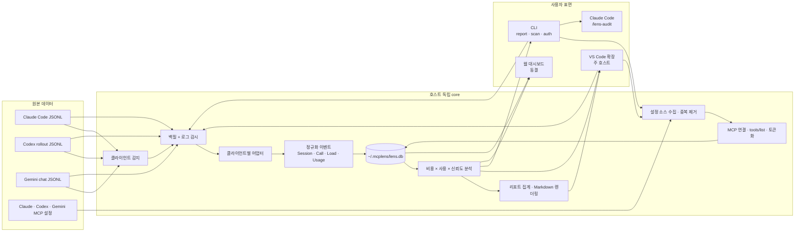
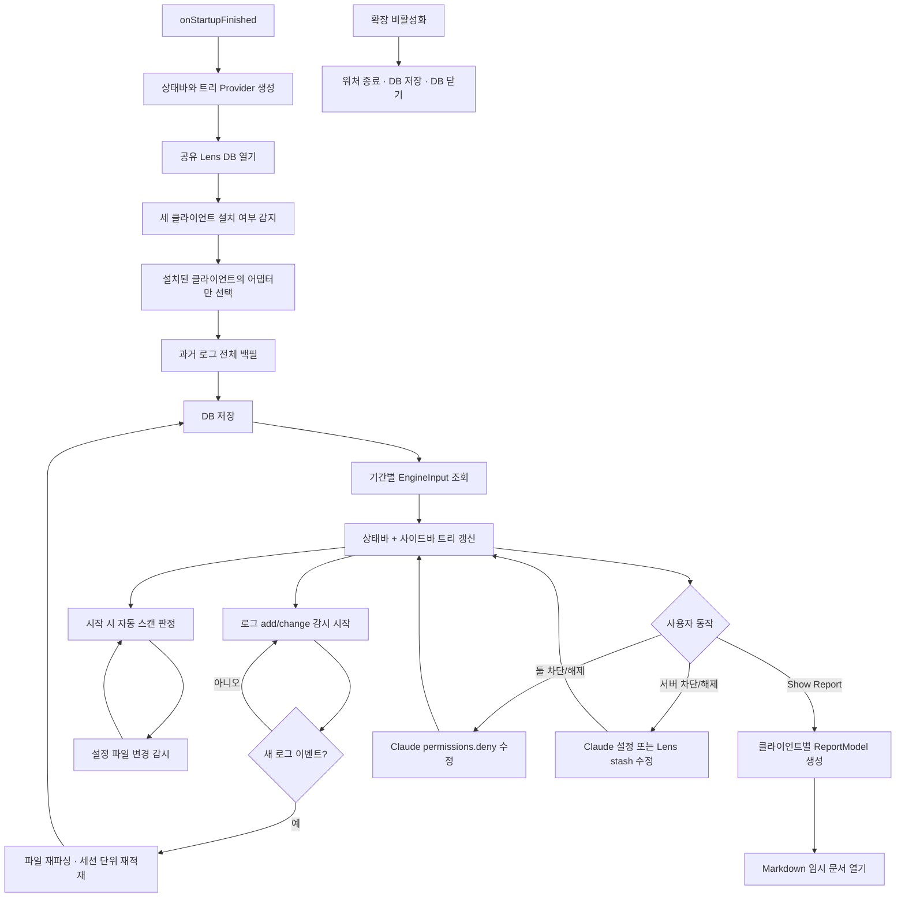
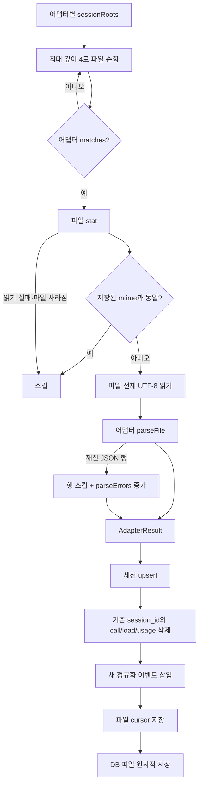
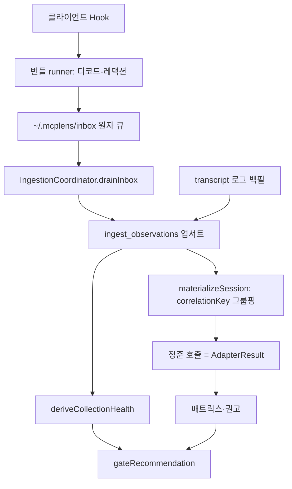
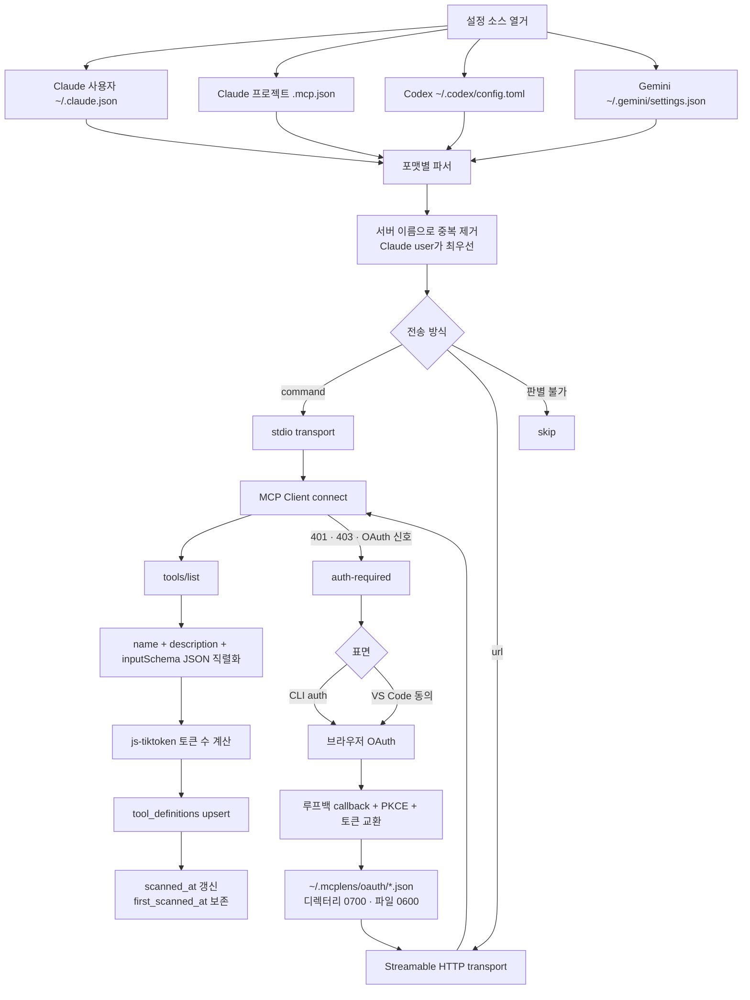
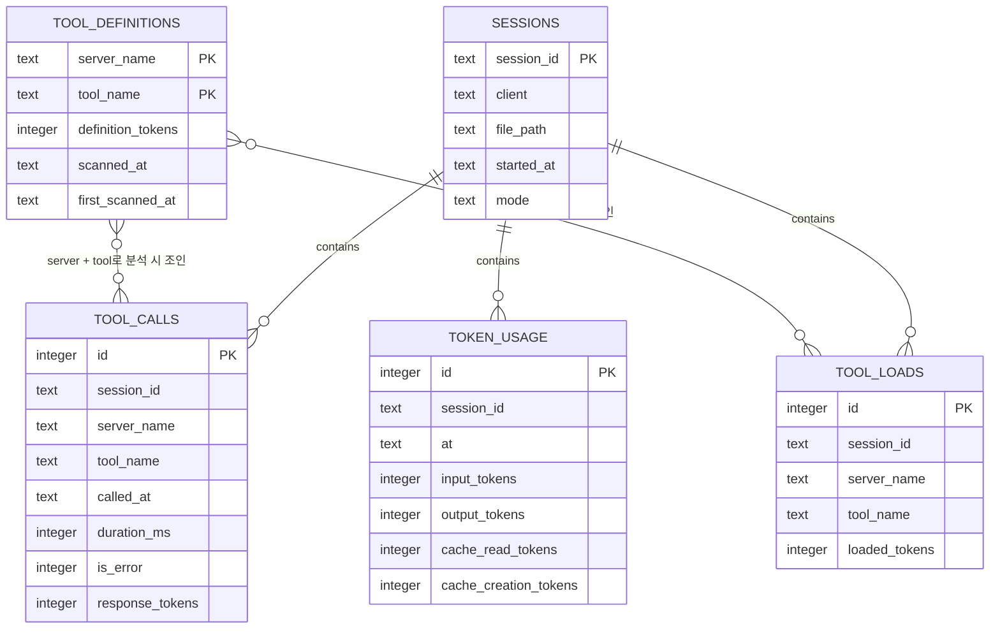
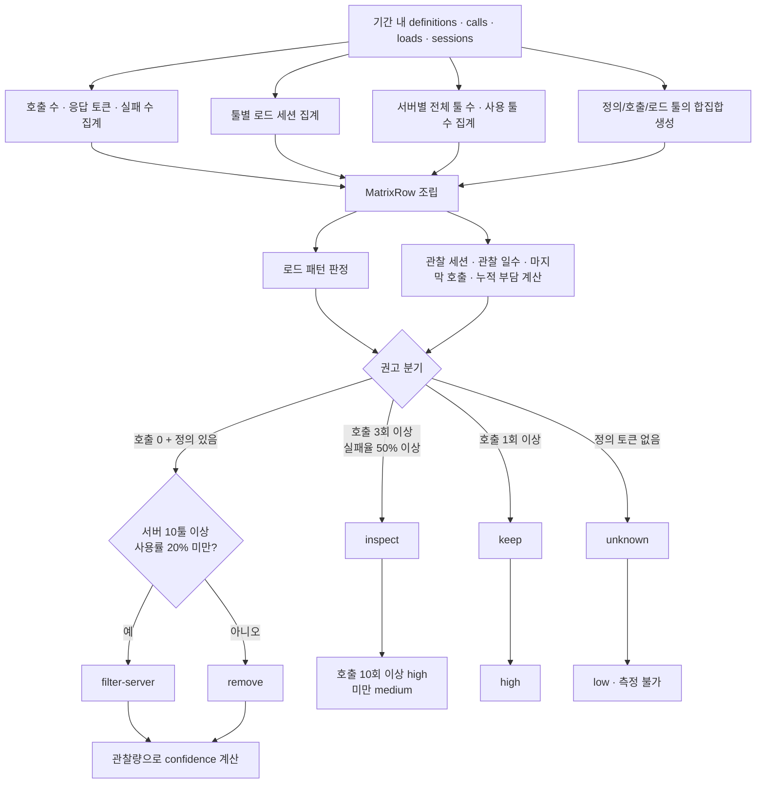
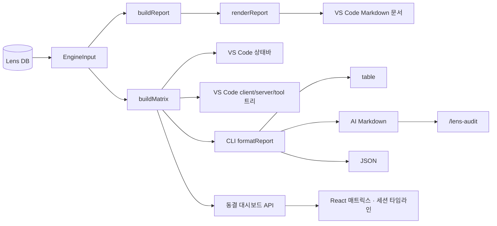
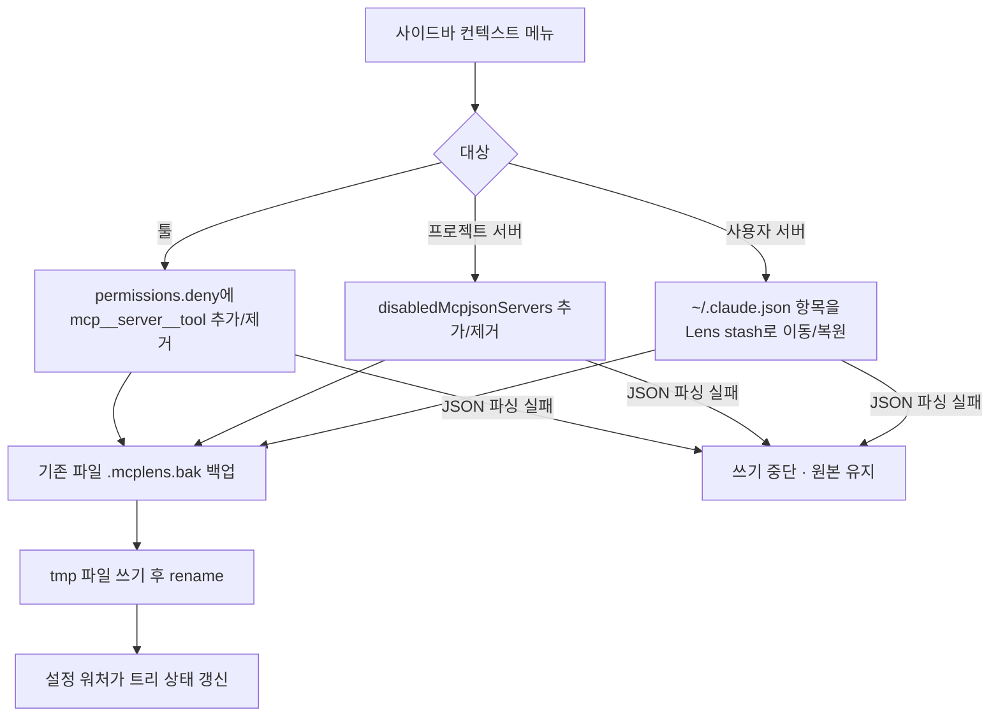

# MCP Lens 전체 시스템 로직과 플로우

> 기준: 2026-07-20 현재 저장소의 실제 구현. 설계 문서보다 실행 코드와 테스트를 우선한다.
>
> 범위: `@mcp-lens/core`, VS Code 확장, CLI, Claude Code `/lens-audit` 플러그인, 동결된 웹 대시보드.

## 1. 시스템의 목적

MCP Lens는 Claude Code, Codex, Gemini CLI의 세션 로그에서 **실제 MCP 툴 사용량**을 수집하고, MCP 서버의 `tools/list`에서 **툴 정의 비용**을 별도로 측정한다. 두 축을 SQLite에 합친 뒤 툴별 비용·호출·실패·로드 패턴을 계산해 `remove`, `filter-server`, `inspect`, `keep`, `unknown` 권고를 만든다.

핵심 입력은 다음 두 갈래다.

- 사용 축: 세 클라이언트의 읽기 전용 세션 로그
- 비용 축: Claude/Codex/Gemini 설정에서 발견한 MCP 서버를 잠시 연결해 얻은 `tools/list`

핵심 출력은 VS Code 상태바·사이드바·Markdown 리포트이며, CLI와 `/lens-audit`이 보조 표면이다. 웹 대시보드는 코드와 테스트만 유지되는 동결 표면이다.

근거: `packages/core/src/types.ts:50-77`, `packages/core/src/engine/engine.ts:24-85`, `packages/extension/src/extension.ts:18-62`, `packages/dashboard/README.md:1-19`.

## 2. 전체 아키텍처 플로우

구조적 경계는 명확하다. `core`는 `vscode`를 import하지 않고, 모든 표면은 `@mcp-lens/core`의 공개 API를 소비한다. 영구 DB 경로는 호스트와 무관하게 `os.homedir()`와 `path.join()`으로 만든 `~/.mcplens/lens.db`다.

근거: `packages/core/src/index.ts:1-29`, `packages/core/src/paths.ts:5-20`, `packages/extension/src/extension.ts:1-13`, `packages/cli/src/main.ts:3-13`, `packages/dashboard/src/server.ts:6-11`.

## 3. VS Code 확장 수명주기

VS Code 확장이 현재 시스템의 주 호스트다.

### 갱신 트리거

- 로그 파일 `add`/`change`: 재수집 후 `ingested` 이벤트가 발생하고 상태바·트리를 갱신한다.
- `mcpLens.reportDays` 변경: 새 기간으로 DB를 다시 조회한다.
- MCP 설정 파일 변경: 2초 디바운스 후 자동 스캔 여부를 다시 판단한다.
- Claude 설정·stash 변경: 툴/서버 활성 상태를 다시 읽어 트리에 반영한다.
- `MCP Lens: Show Report`: `buildReport` → `renderReport`로 Markdown을 만들어 편집기에 연다.

근거: `packages/extension/package.json:15-18`, `packages/extension/src/extension.ts:18-62`, `packages/extension/src/extension.ts:114-144`, `packages/extension/src/autoScan.ts:69-107`.

## 4. 사용 축: 로그 백필과 실시간 수집

현재 워처는 `byte_offset`을 저장하지만 증분 조각만 파싱하지는 않는다. mtime이 바뀌면 파일 전체를 다시 파싱하고, 저장소가 같은 `session_id`의 상세 행을 지운 뒤 다시 넣어 멱등성을 확보한다. DB 저장은 `.tmp` 파일에 export한 다음 rename하는 원자적 교체다.

근거: `packages/core/src/watch/watcher.ts:13-64`, `packages/core/src/store/store.ts:39-69`, `packages/core/src/store/store.ts:85-97`, `packages/core/src/store/store.ts:153-159`, `packages/core/test/watch/watcher.test.ts:17-76`.

## 4-A. Hook 우선 수집 파이프라인

로그 백필이 유일한 수집원이던 모델은 [공식 Hook 우선 수집 설계](designs/2026-07-20-공식-hook-우선-수집-설계.md)로 확장됐다. 세 클라이언트(Claude Code·Codex·Gemini CLI)의 공식 lifecycle Hook을 **호출 사실의 1차 소스**로 삼고, 기존 transcript 로그를 토큰·로드·백필 보강원으로 병합한다.

- **Inbox**: Hook runner는 DB·네트워크를 열지 않고 민감 본문을 제거한 `HookEnvelope`만 `~/.mcplens/inbox`에 원자 기록한다(파일당 1이벤트, `deliveryId`로 멱등). 장기 실행 중인 확장/CLI만 단일 writer로 drain한다.
- **관측 병합**: Hook과 로그는 각각 `ToolObservation`이 되어 `correlationKey`로 묶인다. native 호출 ID가 있으면 `native:` 키로 **정확히 하나의 논리 호출**로 합쳐지고, ID가 없는 Gemini는 세션·툴·phase 기반 `fallback:` 키로 근접 시간 짝짓기한다. 우선순위는 Hook의 신원·에러·지속시간, 그다음 로그의 응답·로드 토큰이다.
- **순서 독립성**: Hook→로그와 로그→Hook은 동일한 정준 결과를 만든다. transcript 재파싱은 Hook 에러·지속시간을 지우지 않는다.
- **수집 건강도**: `deriveCollectionHealth`가 `idle·healthy·hook-only·log-only·degraded·unavailable`을 산출한다. 상관 불일치 3회 누적 시 `degraded`, 2회 일치 시 회복. `gateRecommendation`은 `degraded`·`unavailable`에서 제거·필터 권고를 저확신 후보로 낮추고, `hook-only`에서 토큰 주장을 "측정 불가"로 레댁션한다.
- **롤아웃 상태**: 릴리스 기본값은 `shadow` — Hook 수집은 켜지만 권고 결과는 기존 로그 전용 결과와 동일하게 유지한다. `count-primary`는 Hook을 1차로 계수하고, `health-gated`는 수집 건강도가 `healthy`일 때만 Hook을 계수한다. `shadow`가 기존 권고를 바꾸지 않음은 E2E로 고정한다.

근거: `packages/core/src/ingest/inbox.ts`, `packages/core/src/ingest/coordinator.ts`, `packages/core/src/store/observations.ts`, `packages/core/src/ingest/identity.ts:20-24`, `packages/core/src/health/collectionHealth.ts`, `packages/core/src/engine/healthGate.ts`, `packages/core/test/e2e/hook-pipeline.test.ts`, `packages/core/test/e2e/hook-health.test.ts`.

## 5. 클라이언트별 어댑터 정규화

세 어댑터는 서로 다른 로그 포맷을 공통 `AdapterResult`로 바꾼다.

| 클라이언트 | 로그 위치와 매칭 | 호출 추출 | 로드·모드 판정 | 응답 토큰 |
|---|---|---|---|---|
| Claude Code | `~/.claude/projects/.../*.jsonl` | `tool_use`와 `tool_result`를 `tool_use_id`로 결합, `mcp__server__tool` 분해 | `ToolSearch` 또는 `tool_reference`가 있으면 `DEFERRED_MEASURABLE`; MCP 호출만 있으면 `UPFRONT` | 응답 본문을 `js-tiktoken`으로 추정 |
| Codex | `~/.codex/sessions/.../rollout-*.jsonl` | `mcp_tool_call_end`의 구조화된 `server`, `tool`, Rust `Result` 사용 | `ALL_TOOLS`가 든 `custom_tool_call`과 출력을 `call_id`로 결합하면 `DEFERRED_MEASURABLE` | 호출 응답 토큰은 `null`; 코드 모드 검색 출력만 직접 토큰화 |
| Gemini CLI | `~/.gemini/tmp/.../chats/*.jsonl` | `functionCall`과 `functionResponse`를 id로 결합, `mcp_server_tool` 평탄 이름 분해 | 지연 로드 신호가 없어 MCP 호출이 있으면 `UPFRONT` | 레코드의 `tokens.tool` 사용 |

공통 동작은 다음과 같다.

- 세션 ID는 로그 파일 절대경로 SHA-256의 앞 16자리다.
- JSON 한 행이 깨져도 전체 파싱을 중단하지 않고 `parseErrors`만 증가시킨다.
- MCP 증거가 전혀 없는 세션은 `DEFERRED_OPAQUE`로 저장한다.
- 정규화 결과는 `SessionMeta`, `ToolCallEvent`, `ToolLoadEvent`, `TokenUsageEvent` 네 종류다.

근거: `packages/core/src/types.ts:11-67`, `packages/core/src/adapters/claude/adapter.ts:14-122`, `packages/core/src/adapters/codex/adapter.ts:8-99`, `packages/core/src/adapters/gemini/adapter.ts:55-186`.

## 6. 비용 축: 설정 발견과 정의 스캔

VS Code의 자동 스캔 정책은 `prompt`, `always`, `never` 중 하나다. 이미 정의가 저장된 서버 이름은 알려진 서버로 보고, 새로 발견된 서버만 자동 스캔 대상으로 잡는다. 스캔은 비인터랙티브이며 저장된 토큰으로도 인증이 안 되면 `auth-required`/`token-expired`를 표면에 전달한다. 실제 브라우저 로그인은 CLI `auth` 또는 VS Code 동의 이후에만 수행한다.

근거: `packages/core/src/scanner/sources.ts:46-61`, `packages/core/src/scanner/sources.ts:94-137`, `packages/core/src/scanner/scanner.ts:20-82`, `packages/core/src/store/store.ts:71-83`, `packages/extension/src/autoScan.ts:69-90`, `packages/core/src/scanner/oauth.ts:146-169`, `packages/core/src/scanner/oauth.ts:236-282`.

## 7. 영구 저장 모델

`file_cursors`는 로그 파일별 `byte_offset`과 `mtime_ms`를 별도로 저장한다. 분석 엔진은 현재 `tool_definitions`, `tool_calls`, `tool_loads`, `sessions`를 사용하며, `token_usage`는 수집·보존되지만 매트릭스 계산에는 직접 투입되지 않는다.

근거: `packages/core/src/store/schema.sql:1-50`, `packages/core/src/engine/engine.ts:7-17`.

## 8. 분석 엔진과 권고 결정

### 세부 판정

- `search-pollution`: 로드된 세션이 있는데 호출은 0회다.
- `always-load-candidate`: 호출이 있고 전체 세션 중 50% 이상에서 로드됐다.
- `filter-server`: 미호출 툴이면서 서버가 10개 이상 툴을 제공하고 실제 사용률이 20% 미만이다.
- `inspect`: 호출 3회 이상이면서 실패율이 50% 이상이다.
- `remove`/`filter-server` 확신도는 관찰 5세션·3일 미만이면 low, 시각이 확인된 10세션·7일 이상이고 마지막 호출이 없으면 high, 나머지는 medium이다.
- 모드가 지연 로딩이면 호출도 로드도 없는 툴은 DB에는 남지만 UI/리포트 표시에서 숨긴다. `UPFRONT`이면 미사용 정의도 실제 비용으로 간주해 모두 표시한다.

근거: `packages/core/src/engine/engine.ts:19-85`, `packages/core/src/engine/engine.ts:118-149`, `packages/core/src/engine/engine.ts:156-220`, `packages/core/src/engine/evidence.ts:196-233`.

## 9. 출력 표면별 흐름

### VS Code

- 상태바: 기간 내 호출 수와 `sessionSavings`의 절감 토큰을 요약한다.
- 사이드바: 클라이언트 → 서버 → 툴 트리로 호출·실패·응답 토큰·권고·활성 상태를 보여준다.
- 리포트: 클라이언트별로 분할한 뒤 `act`, `candidate`, `inspect`, `healthy` 버킷으로 묶은 새 리포트 모델을 Markdown으로 렌더링한다.
- Claude Code 전용으로 툴 deny와 서버 disable/enable 컨텍스트 메뉴를 제공한다.

### CLI와 `/lens-audit`

- `report`: 먼저 로그를 백필하고 DB를 기간 조회한 뒤 매트릭스를 `table`, `ai`, `json` 중 하나로 출력한다.
- `scan`: 설정을 발견하거나 `--config`를 읽어 서버별 정의를 스캔·저장한다.
- `auth`: HTTP MCP 서버 OAuth 로그인 후 해당 서버를 즉시 다시 스캔한다.
- `/lens-audit`: `npx mcp-lens report --days 30 --format ai`를 실행하고 Claude가 권고를 요약한다.

### 웹 대시보드

- 로컬 `127.0.0.1:43117` 서버가 `/api/matrix`, `/api/sessions`, `/api/timeline/:sessionId`를 제공한다.
- React 앱은 5초마다 매트릭스와 세션 목록을 폴링하고, 선택 세션의 호출 타임라인을 표시한다.
- 현재는 VS Code 사이드바가 상시 UI 역할을 흡수해 신규 기능 반영이 중단된 동결 표면이다.

근거: `packages/extension/src/extension.ts:45-55`, `packages/extension/src/extension.ts:131-144`, `packages/extension/src/matrixTree.ts:41-109`, `packages/core/src/report/rollup.ts:17-28`, `packages/cli/src/main.ts:15-45`, `packages/cli/src/main.ts:63-161`, `packages/lens-audit-plugin/commands/lens-audit.md:1-18`, `packages/dashboard/src/server.ts:77-143`, `packages/dashboard/src/app/App.tsx:20-73`, `packages/dashboard/README.md:1-19`.

## 10. Claude Code 설정 변경 안전 흐름

사용자 전역 서버를 끌 때는 스펙 유실을 막기 위해 stash를 먼저 기록하고 원본에서 제거한다. 복원할 때는 원위치에 먼저 복구한 뒤 stash를 지운다. 프로젝트 `.mcp.json`은 직접 수정하지 않고 Claude의 `disabledMcpjsonServers` 스위치를 사용한다.

근거: `packages/core/src/permissions/fileUtils.ts:6-18`, `packages/core/src/permissions/claudeSettings.ts:31-50`, `packages/core/src/permissions/claudeServers.ts:93-145`, `packages/core/src/permissions/claudeServers.ts:147-190`.

## 11. 실패와 복구 정책

| 상황 | 현재 동작 |
|---|---|
| 로그 JSON 한 행 파싱 실패 | 해당 행만 건너뛰고 `parseErrors` 증가 |
| 로그 파일이 이벤트 직후 사라짐·읽기 실패 | 파일을 조용히 건너뛰고 나머지 수집 지속 |
| 세션 파일이 변경됨 | 파일 전체 재파싱 후 해당 세션 상세 행을 교체 |
| DB 적재 중 오류 | 트랜잭션 rollback 후 오류 전파 |
| MCP 설정 파싱 실패 | 빈 수집 결과로 처리 |
| MCP 스캔 인증 필요 | `auth-required`로 분류해 CLI/VS Code 로그인 경로로 전달 |
| MCP 스캔 timeout | transport를 닫고 오류 처리, client는 finally에서 종료 |
| Claude 설정 JSON 파손 | 쓰지 않고 오류 표시; 읽기 UI는 가능한 범위에서 계속 |
| 대시보드 DB 파일 변경 | 다음 API 요청 전에 mtime을 보고 store 재오픈 |

근거: `packages/core/src/watch/watcher.ts:47-64`, `packages/core/src/store/store.ts:39-69`, `packages/core/src/scanner/sources.ts:64-105`, `packages/core/src/scanner/scanner.ts:46-82`, `packages/extension/src/extension.ts:36-44`, `packages/dashboard/src/server.ts:77-108`.

## 12. 현재 구현에서 알아둘 경계와 한계

아래는 설계 의도가 아니라 현재 코드에서 직접 확인되는 구현 경계다.

1. 워처는 byte cursor를 저장하지만 변경 파일을 증분 파싱하지 않고 전체 재파싱한다. 데이터 정합성은 세션 단위 교체로 유지된다.
2. `token_usage`는 저장되지만 현재 매트릭스·권고 계산에는 사용되지 않는다.
3. Codex 코드 모드 로드는 `serverName: null`, `toolName: "(code-mode-search)"` 집계로 저장된다. 현재 `sessionSavings`는 정의 키와 일치하지 않는 로드를 제외하므로 이 로드 토큰을 정의별 실제 비용으로 연결하지 않는다.
4. `sessionSavings`는 세션 모드로 `UPFRONT` 비용을 별도 보정하지 않고, 정의와 키가 맞는 `tool_loads`만 실제 비용으로 합산한다. 따라서 여러 클라이언트가 섞인 전역 절감 숫자는 “정의 전량 대비 관찰된 매칭 로드”에 가깝고, 설계 문서의 완전한 세션별 실비용 공식과 동일하다고 단정할 수 없다.
5. VS Code 리포트는 새 `buildReport`/`renderReport` 경로를 사용하지만 CLI와 `/lens-audit`은 기존 `formatReport(buildMatrix(...))` 경로를 사용한다. 두 출력의 그룹핑과 문구는 같지 않다.
6. 동결 대시보드는 `lastCallByTool`을 `EngineInput`에 넣지 않으므로 VS Code/CLI보다 과거 호출을 반영한 확신도 보정이 약하다.
7. 웹 대시보드의 파일 DB 재로딩은 비동기 요청 경합 가능성이 백로그에 남아 있으나, 표면 동결로 수정 계획은 없다.

근거: `packages/core/src/watch/watcher.ts:46-63`, `packages/core/src/store/schema.sql:33-47`, `packages/core/src/engine/engine.ts:87-106`, `packages/core/src/adapters/codex/adapter.ts:55-76`, `packages/extension/src/extension.ts:131-144`, `packages/cli/src/main.ts:27-45`, `packages/dashboard/src/server.ts:36-43`, `docs/BACKLOG.md:18-27`.

## 13. 근거와 추론의 구분

### 직접 확인된 사실

- 세 클라이언트 로그가 하나의 공통 타입과 DB 스키마로 정규화된다.
- 정의 스캔과 로그 수집은 독립 입력축이며 DB와 엔진에서 결합된다.
- VS Code 확장이 상시 수집·자동 스캔·주 UI를 담당한다.
- CLI, 플러그인, 대시보드는 같은 core/DB를 소비하지만 출력 경로와 최신화 수준은 서로 다르다.
- 픽스처 E2E 테스트는 세 어댑터 결과가 하나의 매트릭스로 합쳐지고 오류 호출·로드 이벤트가 보존됨을 검증한다.

근거: `packages/core/test/e2e/pipeline.test.ts:14-89`.

### 코드에서 도출한 해석

- 시스템의 중심은 특정 UI가 아니라 `AdapterResult → LensStore → EngineInput → MatrixRow/ReportModel` 데이터 계약이다. 이 계약 때문에 새 클라이언트나 새 표면을 기존 파이프라인 양끝에 추가할 수 있다.
- 운영 관점에서 주 경로는 VS Code 확장이고, CLI는 수동 스캔·인증·자동화/AI 소비 경로다.

### 저장소만으로 확정할 수 없는 것

- 현재 사용자 머신의 실제 로그·DB가 어느 정도 채워졌는지와 권고 결과.
- 외부 MCP 서버의 가용성, OAuth 제공자별 호환성, 실제 네트워크 지연.
- 비공식 클라이언트 로그 포맷이 향후 버전에서도 동일하게 유지되는지.
