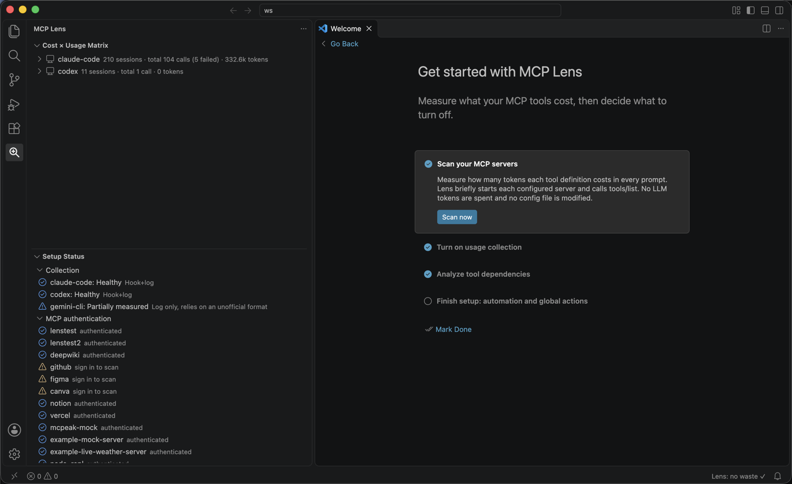
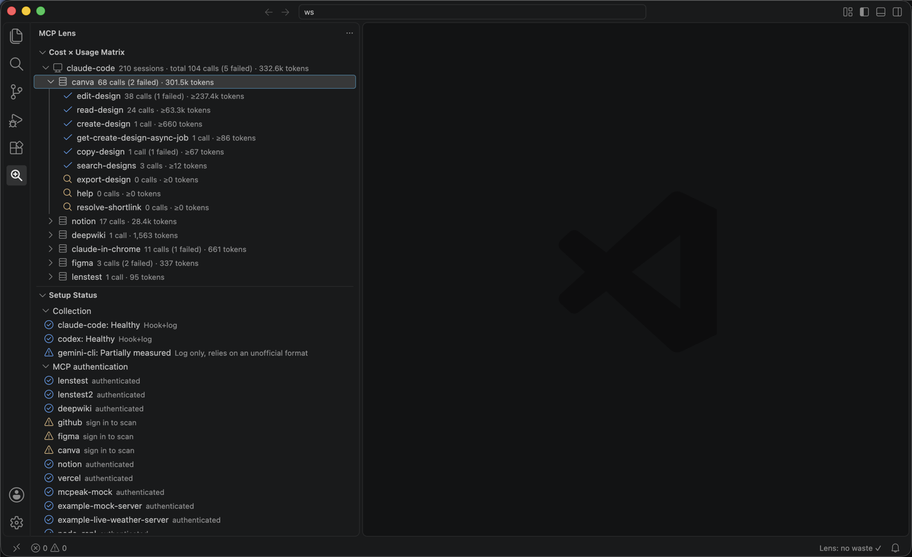
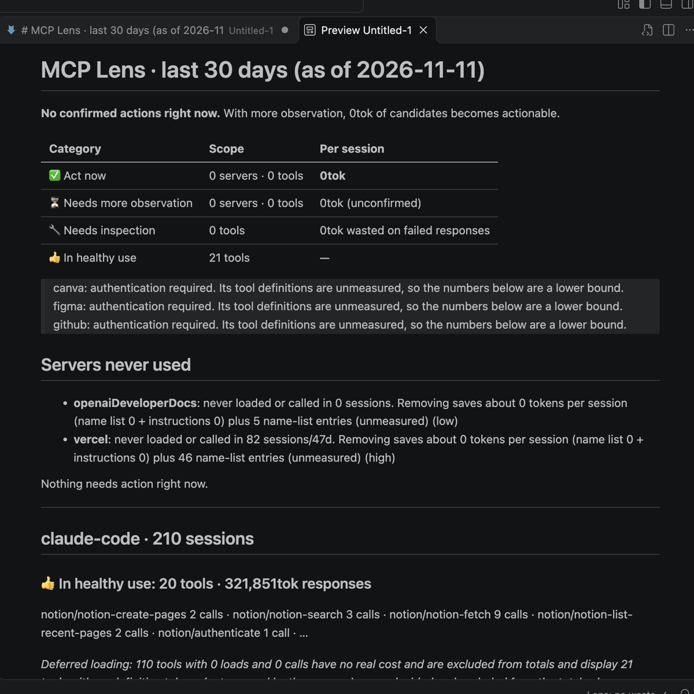

# MCP Token Lens

Every MCP server you connect injects its tool definitions into every prompt, whether you call those
tools or not. MCP Token Lens measures what each server and tool costs in tokens, records how often
you actually use it across **Claude Code**, **Codex**, and **Gemini CLI**, and puts the two side by
side so you can decide what to turn off.

## Features

### Cost × Usage Matrix

An activity-bar view that lists client ▸ server ▸ tool, sorted with the most expensive first. Each
row shows calls, failed calls and tokens, so tools that cost a lot and are rarely used stand out.

### Report

**MCP Lens: Show Report** opens a per-client Markdown report for the last `mcpLens.reportDays` days:
servers that were never used, tools that only fail, and how many tokens per session removing them
would save. Servers whose definitions could not be measured are called out, so a number is never
presented as more certain than it is.

### Setup Status

See at a glance whether usage collection works for each client and which MCP servers still need a
sign-in before they can be measured. Install or remove hooks directly from the rows.

### Tool dependency analysis (optional)

**MCP Lens: Analyze Dependencies** checks which tools can be turned off without breaking others,
using cross-references in the definitions, real call chains and, where needed, an LLM verdict. It
runs through your own Claude or Codex CLI, so it spends that account's tokens. You are told the
expected cost and what is sent before it runs. Only tool definitions and aggregated usage counts are
sent: never prompts, tool inputs, tool outputs or source code.

### Global disable and restore (opt-in)

**MCP Lens: Disable Globally** turns unused tools off in the client config, and **Restore Globally**
puts them back. It is locked until you name the allowed clients in
`mcplens.dependencyAnalysis.rollout`, and it shows what will be lost before it runs.

## Getting started

1. Install the extension. A walkthrough opens on first launch.
2. **Scan your MCP servers.** Lens briefly starts each configured server and calls `tools/list` to
   count definition tokens. No LLM tokens are spent and no config file is modified.
3. **Turn on usage collection.** Hooks record how often each tool is actually called.
   Codex also needs you to approve the hooks under `/hooks`, and Gemini CLI needs a restart.
4. Open the **MCP Lens** view in the activity bar.

Original client logs are only ever read, never modified. Data is stored locally in
`~/.mcplens/lens.db`, and no account is required.

## Settings

| Setting | Default | Description |
|---|---|---|
| `mcpLens.reportDays` | `30` | Days the status bar and report aggregate over. Lens keeps history after client logs expire. |
| `mcpLens.reportDetail` | `summary` | `summary` or `full` detail for the report. |
| `mcpLens.autoScan` | `never` | Scan servers you add later: `prompt`, `always` or `never`. |
| `mcpLens.autoAnalyze` | `false` | Analyze newly scanned tools automatically (spends provider tokens). |
| `mcpLens.inferenceProvider` | `auto` | Provider for dependency analysis: `auto`, `claude` or `codex`. |
| `mcplens.dependencyAnalysis.rollout` | `off` | Clients allowed to use global actions: `off`, `claude`, `codex` or `all`. |

## Support

Report issues at [github.com/seodduu/MCPLens/issues](https://github.com/seodduu/MCPLens/issues).
